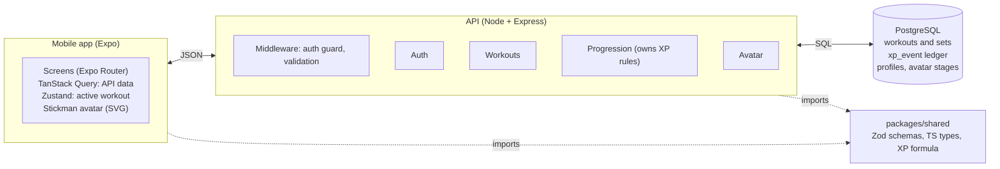

# Level Up — Project Context & Architecture

_Last updated: 2026-11-16 · Source of truth for architecture decisions. Keep this file in sync when decisions change._

## Vision & MVP scope

Level Up is "an RPG that improves your real body": logging real workouts earns XP, XP raises your level, and your avatar visibly grows with you. It is a portfolio project built to production standards, with the goal of launching on the app stores.

**The MVP is one core loop, done well:**

1. Log a workout (exercises, sets, reps, weight).
2. The server awards XP for it.
3. XP raises your level.
4. Your avatar changes as you level up.

**In the MVP:** register and log in, a predefined exercise library, workout logging that tolerates bad gym signal, XP and levels with a weekly consistency streak, a stickman avatar that grows, and a home screen showing avatar, level and XP bar.

**Deferred until the loop works:** custom exercises, cosmetics shop and unlocks beyond growth stages, quests, muscle-group variety bonus, achievements, the rules-based coach, leaderboards, social features, and any AI.

## Working agreement

This project is a learning experience as much as a product. Claude acts as a senior engineer mentoring a junior developer, not as a code generator.

- Explain every architectural decision, and why one option beats another.
- Point out trade-offs; when several good solutions exist, say why one was chosen.
- Explain what each file and class is responsible for, and why it lives where it does.
- Explain framework internals (React Native, Expo, Express, Prisma, Postgres) instead of assuming prior knowledge.
- Follow Clean Architecture, SOLID and single-responsibility where they help; prefer maintainability over cleverness.
- Small, meaningful Git commits; good documentation alongside the code.
- Flag design issues early, and explain the reasoning before changing an agreed design.

## Tech stack

TypeScript runs end to end, so types are shared between the app and the API. This stack replaces the earlier Flutter + Firebase version (paused at Milestone 3, October 2026).

| Layer | Choice | Why |
| --- | --- | --- |
| Mobile app | React Native + Expo + TypeScript | One codebase for iOS and Android; Expo handles builds, store submission and over-the-air updates |
| Navigation | Expo Router | File-based routes, auth-guarded route groups, deep linking |
| Server data | TanStack Query | Caching, retries and refetching for API data |
| Local UI state | Zustand (persisted to `expo-sqlite/kv-store`) | Holds the in-progress workout and the outbox of finished workouts on the device |
| API | Node.js + Express + TypeScript | Own backend; the service layer owns all workout, XP and level rules |
| Validation | Zod (shared) | One schema validates requests on the server and forms in the app |
| Database | PostgreSQL + Prisma | Relational data fits workouts and sets; Prisma gives typed queries and migrations |
| Auth | Better Auth (library inside our API) | Proven password and session handling without vendor lock-in |
| Local dev | Docker Compose | Runs Postgres locally the same way every time |
| Tooling | VS Code, Git, GitHub, MacBook Air M3 | |

## Architecture principles

Six rules keep the app simple today and launchable later. Each one is recorded with its trade-off in the decision log.



The Progression module is the only place XP is calculated; the app and API share types and the level formula through `packages/shared`.

1. **Modular monolith.** One API, split into modules (auth, users, exercises, routines, workouts, progression, avatar). Each module owns its routes, service and data access. Modules talk through service functions, never each other's tables. One Node server plus Postgres can serve tens of thousands of users; a module can be split out later if it ever needs to be.
2. **The server owns the game rules.** The app sends what was lifted, never how much XP to award. This blocks cheating before leaderboards exist, and lets us rebalance progression without an app update.
3. **XP is a ledger.** Every XP gain is its own row. Total XP is the sum; level is calculated from total XP. A cached total on the user keeps reads fast, but the ledger is the source of truth.
4. **Offline-tolerant logging.** The in-progress workout lives on the phone. "Finish" sends the whole workout in one request with a client-generated ID (`clientId`, unique per user), so a retry on bad signal cannot count the workout twice (an idempotent request): the first call returns 201, any repeat returns 200 with the workout already saved.
5. **Proven auth, not home-made.** Better Auth handles password hashing, sessions and resets inside our own API.
6. **Cosmetics are data, not code.** Avatar stages and items live in the database with their unlock rules, so new content needs no app release.

Each API module follows the same layering: route → controller (HTTP in/out) → service (business rules) → repository (Prisma queries) → Postgres. Controllers never hold rules; services never know about HTTP.

Module dependencies point one way: **workouts → exercises, routines, users, progression**, and **progression → users**; nothing depends back on workouts. Finish writes through several modules in one transaction: each repository function that takes part accepts a `db` argument (`lib/prisma` `Db`), and the workouts service passes the transaction client (a "unit of work"). Modules own data and rules, not URL prefixes: `/exercises/:id/summary` and `/exercises/recent` are built from workout history, so they live in the workouts module. Services report expected failures by throwing an `AppError` with a domain `kind` (`not_found`, `conflict`) and a stable `code` (e.g. `UsernameTaken`); the one error handler maps it to a status code, and every error response has the shape `{ error, message, issues? }`. Request bodies are checked by a `validateBody(schema)` middleware using the shared Zod schemas.

## Repository structure

One monorepo holds the app, the API and the shared types, managed with pnpm workspaces. A change to an API contract and the app code that uses it land in the same commit.

```text
Level-UP/
├── apps/
│   ├── mobile/                 # Expo app
│   │   └── src/
│   │       ├── app/            # Expo Router screens: sign-in, sign-up, (app)/ behind the auth guard
│   │       ├── components/     # reusable UI (Button, Card, SetRow, Avatar)
│   │       ├── features/       # auth, profile, exercises, routines, workouts, progress; avatar later
│   │       ├── theme/          # tokens, fonts, contrast checks
│   │       ├── lib/            # API client, query client, storage
│   │       └── stores/         # Zustand stores (active workout)
│   └── api/                    # Express API
│       ├── prisma/schema.prisma
│       └── src/
│           ├── modules/        # health, users, exercises, routines, workouts, progression; avatar later
│           ├── lib/            # Better Auth setup, Prisma client, errors, clock
│           ├── middleware/     # auth guard, error handler, request validation
│           ├── config/         # env loading and checks
│           └── app.ts
├── packages/
│   └── shared/                 # Zod schemas, TS types, XP formula
├── docs/                       # Architecture, Decisions, Roadmap, DevelopmentJournal
├── docker-compose.yml          # local Postgres
├── .github/workflows/          # CI
├── CLAUDE.md                   # context for Claude in VS Code
└── README.md
```

The XP-to-level formula lives in `packages/shared`, but only the server uses it to decide levels: the API sends each player's level, XP into the level and XP needed for the next one, and the app just draws them. So the curve can be rebalanced without an app update (from Milestone 5; before that the app ran the formula itself).

## Initial data model

These tables cover the MVP. Better Auth creates and owns its own user, session and account tables; our `profile` table extends that user with game data.

| Table | Key fields | Purpose |
| --- | --- | --- |
| profile | user_id, username (citext: unique ignoring case), total_xp (cached), weight_unit (kg or lb), time_zone (IANA, from the phone), created_at (sign-up: decides the warm-up week) | Game identity for each user |
| bodyweight_entry | id, user_id, kg (3 decimals), measured_on (date) | Bodyweight history. XP uses the entry in effect on the workout's date (75 kg fallback when there is none) |
| exercise | id, slug, name, muscle_group, body_part, equipment, mechanic (compound or isolation), reps_unit (reps or seconds), suggested_rest_sec, load_factor, bodyweight_ratio, is_custom, owner_id | Predefined library (seeded from `exercise-catalog.ts`, upserted by slug); custom exercises via owner_id. Tuning values are sent to the app for display; the server recomputes |
| exercise_preference | user_id, exercise_id, rest_sec | The player's own choices per exercise (rest time first). Highest priority: preference > routine > exercise suggestion > 120 s |
| routine | id, user_id, name, created_at, updated_at | A saved plan |
| routine_exercise | id, routine_id, exercise_id, order, target_sets, target_reps, rest_sec | The plan's exercises. A workout COPIES these when it starts, so editing a routine never changes history |
| workout | id, user_id, client_id (unique per user), routine_id (optional link; cleared if the routine is deleted), name, started_at, finished_at | One gym session; client_id makes "Finish" safe to retry. History is ordered by started_at |
| workout_exercise | id, workout_id, exercise_id, order, rest_sec | Which exercises were done, in order (exercises in history can't be deleted) |
| workout_set | id, workout_exercise_id, reps, weight_kg (3 decimals), set_order, completed_at, is_flagged, flag_reason | Each set performed. weight_kg is per dumbbell for dumbbell lifts and added weight for bodyweight exercises; plank logs seconds in reps for now |
| xp_event | id, user_id, amount, source, source_id, body_part, earned_on (local date, Milestone 5), created_at | The XP ledger: one row per XP gain (one per completed set for workout XP). Unique on (source, source_id), so a repeated request can never award XP twice. `earned_on` is the local calendar day the workout STARTED (the daily cap's day); `created_at` is only when the server received it |
| weekly_goal | id, user_id, week_start (local Monday), kind (goal or warm_up), target, days_trained, met, streak_after, met_by_workout_id, closed_at | One row per player per week, created lazily (no cron job). Unique on (user_id, week_start). Bonuses use its id as the ledger source_id |
| user_achievement | user_id, key (e.g. streak_12), source_id, awarded_at | Badges, awarded once each (primary key user_id + key) |
| avatar_stage | level_required, name, asset_key | Stages of the avatar (the extras each level unlocks), stored as data. A player's stage is derived from their level, never stored on the profile (Milestone 6) |
| cosmetic | id, slot, name, unlock_rule | Later: unlockable items (hair, outfit, pose) |

**XP source (decided for Milestone 3, can change later):** volume. Workout XP comes from sets × reps × weight, plus a flat bonus for meeting the weekly goal and bigger ones at streak milestones (see the XP section). So no exercise is penalised for its natural load, each set uses an effective load: weight + (bodyweight × the exercise's bodyweight_ratio), multiplied by the exercise's load_factor. A push-up counts part of your bodyweight, a pull-up counts all of it, and a light isolation lift like a lateral raise gets a higher load_factor so a hard set earns about as much as a hard squat set. Both values are tuned per exercise in the database. From Milestone 5 the load is also **relative to bodyweight** (see XP per completed set), so a lighter player earns as much for a hard set as a heavier, stronger one. Later, training several muscle groups earns more than repeating one.

## XP & level system

Level is never stored as truth: it is calculated from total XP, so the curve can be rebalanced at any time. The starting curve makes each level take a little longer than the last:

```
XP to reach level n = 100 × (n − 1)^1.5
```

That puts level 2 at 100 XP, level 5 at 800 XP, level 10 at 2,700 XP and level 20 at about 8,300 XP. These numbers are a first guess to tune once real workouts are logged.

**Being replaced in Milestone 5.** Real sessions earn about 1,500 XP, so this curve reaches level 20 in under two weeks. The proposal is about 1,000 × (n − 1)^1.85 (level 5 in about 3 weeks, level 10 in about 3 months, level 20 in about a year), with the weekly bonus (+60) and streak milestones (+500 / +1,200 / +3,000) below scaled up to match. Final numbers come from the balancing simulation; this section is rewritten when they are agreed.

- **Where XP comes from:** workout volume plus the weekly goal and streak milestones (MVP); muscle-group variety, quests and achievements later, each as a new `source` in the ledger.
- **Weekly goal** (all values in `WEEKLY_GOAL`, `packages/shared/src/weekly-goal.ts`): everyone starts at 2 training days a week; met → next week +1 (max 4), missed → −1 (min 2). A training day is a workout with at least 3 completed sets, counted once per local calendar day, by the day the workout started. Weeks run Monday to Sunday in the player's time zone. Meeting the goal pays a flat +60 XP at once (mid-week), once per week. The week of sign-up is a warm-up (set XP only, no bonus, no streak, target unchanged) unless sign-up was on its Monday.
- **Streak:** consecutive weeks with the goal met; a missed week resets it to 0. Milestones pay +500 (12 weeks), +1,200 (26) and +3,000 (52) every time they're reached, also after a reset; the badge is awarded once. Weekly and streak bonuses are outside the daily XP cap. A future "rest week" pass is one more week kind that pauses target and streak, like the warm-up.
- **Rollover is lazy:** `GET /weekly-goal` (opening the app) and Finish close every week that ended since the last visit, in order, then open the current one. The app waits until its outbox is empty before asking, because a closed week is final: a workout that arrives after its week closed earns set XP only.
- **XP per completed set** = round(reps × effective kg × (75 / bodyweight) / 10), where effective kg = (kg + bodyweight × `bodyweight_ratio`) × `load_factor` (relative to bodyweight from Milestone 5; before that the 75 / bodyweight factor was missing). Bodyweight is the entry in effect on the workout's date (75 kg if none). A 0 kg pull-up therefore still earns XP.
  - **Why relative to bodyweight:** XP rewards effort, not absolute strength. A 60 kg player benching 40 kg × 8 and a 90 kg player benching 60 kg × 8 earn the same. The 75 kg reference keeps a 75 kg player's numbers unchanged, so the daily cap and level curve stay in the same range.
  - Pure bodyweight exercises earn the same at any bodyweight (a pull-up's load is your bodyweight, which then divides out), which is fair: everyone lifts themselves.
  - **Anti-cheat:** entering a low bodyweight would inflate barbell XP (an 80 kg lifter claiming 40 kg would double it). So XP uses an **XP bodyweight**: the recorded history, walked in date order, where each new entry can move the value by at most 2% per week of time since the previous entry, and the result is clamped to 40-200 kg. The allowance builds up with time, not per entry, so infrequent updates are fine: 5 kg lost over two months and entered once moves fully (an 80 kg player has about 13 kg of allowance after 8 weeks), and so does 10 kg lost during a year away. Only change that is faster than about 2% a week lags, and it catches up over the following weeks. A fake overnight drop takes months to pay off.
  - The time between entries is measured by when the SERVER received them (`created_at`), not the date the player typed (`measured_on`), so backdating an entry can't create allowance. It is a pure function over the bodyweight history in `packages/shared` (`BODYWEIGHT_XP.maxChangePerWeek`), tested and included in the simulation.
  - The app still shows and stores the bodyweight the player typed; only XP uses the limited value. The first entry is taken as typed (a new account can't be checked against anything). Old workouts keep the value in effect on their date, as before.
  - PRs, estimated 1RM, volume and "BW + x kg" always use real kilograms; the bodyweight factor applies to XP only.
  - Trade-off: a heavier, stronger player earns a little less per kg lifted than before. This is one function in `packages/shared`, so it is easy to swap.
- **Personal records** (calculated on read from logged sets): estimated 1RM by Epley, kg × (1 + reps / 30), on lifted kg (logged weight plus the bodyweight share; real kilograms, never XP's scaled load); a single rep counts as the weight lifted. Sets above 12 reps don't count toward estimated-1RM PRs; they are tracked as "most reps at a weight". Timed exercises (plank) use the longest hold. Bodyweight sets are shown as "BW + x kg".
- **Coach hint** (fixed rules, no AI): double progression. Raise the weight only when every set hit its target reps last time; the increment is configured per equipment type (default +2.5 kg barbell and machine, +1 kg per dumbbell).
- **Who calculates it:** the progression service on the server, in the same database transaction that saves the workout. The app runs the same shared functions only to show live XP, PRs and hints during a workout; the server recomputes and is the only one that awards anything.
- **Where the formula lives:** `packages/shared`, with unit tests. The server is the only one that turns XP into levels; the app shows the level progress the API sends (`level`, `xpIntoLevel`, `xpForNextLevel`). The app still uses the shared set formula for the live XP preview during a workout.
- **Balancing is tested with a simulation, not only unit tests.** A committed script (`packages/shared`, run with one command) prints XP per session, days to the daily cap and time to each level for set player types: beginner, intermediate, advanced, a light lifter (about 60 kg) and a bodyweight-only player. It is rerun whenever an XP constant changes, and its output is pasted into the decision-log entry for that change. Real tuning happens in the beta.
- **Level-up moment:** the "Finish workout" response returns XP gained, old level and new level, so the app can play the level-up screen without a second request.

**Limits against fake or inflated workouts** (values to tune later):

- **Daily soft cap:** full XP up to a daily limit, then 25% XP beyond it, with a hard ceiling at twice the limit. A soft cap rewards a genuinely big day without making a fake 1,000-pull-up day worth it. Three rules keep it honest:
  - **The cap's day is the day the workout started**, in the player's time zone (the same rule as training days), stored on each ledger row as `xp_event.earned_on`. `created_at` is when the server received the row, so an offline workout synced two days late would otherwise count against the wrong day.
  - **Lock, then count.** Finish locks the player's profile row (`SELECT ... FOR UPDATE`, as the weekly rollover does) BEFORE it sums the day's XP and awards more. Without the lock, two Finishes arriving together could each see room under the cap.
  - **Old workouts earn no XP.** `startedAt` comes from the phone, so a cheat could spread fake workouts over past days, each under its own cap. A workout that started more than 14 days before the server received it is still saved (history and PRs), but earns no XP. Future times are already rejected by the shared schema.
- **Plausibility checks per set:** reps or weight far beyond a realistic range for that exercise earn no XP and are flagged instead of rejected, so honest typos can be fixed. Status (2026-11-16): the shared schema has global limits (`REPS_MAX`, `WEIGHT_MAX_KG`) and Finish already skips flagged sets for XP and PRs, but nothing sets `is_flagged` yet. Per-exercise ranges arrive with Milestone 5; until then the daily cap is the main defence. Timed exercises get their own maximum (seconds), separate from `REPS_MAX`.
- **Jumps against the player's own history** (Milestone 5): a set far above the player's best for that exercise earns XP as if it were exactly at the 25% line, is marked (`flag_reason` above_history; not `is_flagged`, because it still earns capped XP) and isn't a PR. Two comparisons, so no rep range slips through:
  - **Sets of 1 to 12 reps:** estimated 1RM against the player's best estimated 1RM.
  - **Sets above 12 reps** (which estimated 1RM ignores): the set's volume, reps × lifted kg, against the player's best single-set volume. So 60 kg × 8 last week and 60 kg × 80 this week is caught.
  - **Timed exercises:** seconds held against the longest hold. An honest big jump still earns XP; 60 kg one week and 500 kg the next earns almost nothing extra.
  - The baseline for the next check uses the capped value, so a lifter who really got stronger catches up within a few sessions instead of staying capped forever. A cheat gains at most 25% per session, still inside the daily cap and the absolute limits.
  - The first session of an exercise has no history, so only the absolute limits apply.
  - The 25% is a constant in `xp-limits.ts`, tuned with the simulation and the beta. Retuning changes future workouts only; XP already in the ledger is final.
- **Special events later:** marathons and other big efforts get their own XP source with its own limits, rather than raising the daily cap for everyone.
- **Server-side only:** all caps run in the progression service, so they can be tuned without an app update.

## Avatar prototype: a stickman that grows

The first avatar is a stickman drawn in code with `react-native-svg`. No art assets are needed, and growth is just numbers: limb thickness, shoulder width and head size change with the stage. Later we can swap the renderer for layered 2D art (and possibly 3D after that) without changing the data model.

**Each body part grows on its own.** Every exercise belongs to a body part (chest, back, shoulders, arms, core, legs), and its XP also counts toward that part. Skip leg day and the stickman's legs stay thin while the arms grow.

**Level unlocks, body-part XP shapes** (decided 2026-11-16). The two never mix:

- **Overall level** (from total XP) unlocks things: stages, titles, cosmetics, the headband, the cape, the glow. It never makes a limb bigger.
- **Body shape** comes only from body-part XP. A player who only trains upper body has a high level, a cape and thin legs.
- **Untrained parts shrink slowly.** After a two-week grace period, a body part's development declines slowly, so a few weeks off cost a little and only about a year without training brings it back to the starting shape. XP and level are never lost; only the shape changes. Calculated on read from the ledger's dates (no scheduled job), like the weekly goal. The exact decay curve is set in Milestone 6 with the simulation.
- **Starting shape (open, decided in Milestone 6):** an experienced lifter shouldn't start as a thin stickman. Proposal: calibrate the starting shape from the first two weeks of logged lifts relative to bodyweight, rather than a self-reported baseline, which anyone could exaggerate. Either way it sets the starting shape only; everyone starts at level 1.

- Body-part XP is tracked in the ledger (`xp_event.body_part`, with `earned_on` as its date), so it can be rebalanced like overall XP. Shrinking needs to know WHEN each part was trained, so a plain total per part isn't enough: development is calculated from the dated rows, and any cache holds the value plus the date it was last trained (Milestone 6).
- The avatar takes one development value per body part (for example 0 to 1) and draws each limb from it. The same values will drive the layered 2D or 3D art later.
- To encourage balanced training, the home screen points out the weakest body part, and the later variety bonus gives extra XP for training neglected parts.

| Stage | Unlocks at | Look |
| --- | --- | --- |
| Rookie | Level 1 | Plain stickman |
| Regular | Level 5 | Wristbands and a title |
| Athlete | Level 10 | Sports outfit |
| Champion | Level 15 | Headband |
| Legend | Level 20 | Cape and a glow |

Stages add extras only; limb size, shoulder width and chest come from body-part development. Stage levels are rechecked against the new level curve in Milestone 5.

- The `Avatar` component takes a stage config (extras) and one development value per body part, never a level, so the art and the rules stay separate.
- Stage thresholds live in the `avatar_stage` table and can be tuned without a release.
- A small growth animation plays on the level-up screen when the stage changes.

## Production readiness plan

These are designed in from day one but switched on when the milestone needs them, so none of them slows down the first build.

| Concern | Approach | When |
| --- | --- | --- |
| Code quality | ESLint, Prettier, strict TypeScript | Milestone 1.5 |
| CI | GitHub Actions: type check, lint and tests on every push | Milestone 1.5 |
| Tests | Vitest unit tests for pure logic (XP formula, shared schemas); Jest (`jest-expo`, as Expo recommends) for the app's workout and outbox logic; API integration tests with Supertest against a real Postgres test database (`levelup_test`, wiped before each test; CI uses a Postgres service container) | From Milestone 2 |
| Config and secrets | `.env` files validated at startup with Zod; never committed | Milestone 1.5 |
| Errors and crashes | Sentry in the app and the API | Before beta |
| Hosting | API in a Docker container on a managed host; managed Postgres with backups | Before beta |
| App builds | Expo EAS builds, store submission, over-the-air updates | Before beta |
| Security | Helmet headers, input validation on every route | Milestone 2 onwards |
| Rate limiting | Better Auth's own limiter on `/api/auth`; a limiter on our routes (per user, stricter on writes). Needs `trust proxy` set correctly once the API sits behind the host's proxy | Before beta |
| API versioning | Our routes live under `/v1`; `/api/auth` and `/health` stay unversioned. Old app versions stay on phones for months, so a breaking change becomes `/v2` next to `/v1` | Before Milestone 5 |
| Password reset and email verification | Better Auth's reset and verification flows, with a transactional email provider (still to choose) | Before beta |
| Account deletion | `DELETE /v1/me`, asking for the password again. Every table cascades from `user`, so one delete removes everything. Required by the App Store and Google Play | Before beta |
| Privacy | Privacy policy and store data-safety forms (bodyweight and training history are personal data: POPIA, GDPR) | Before beta |
| Local test files | curl cookie jars and other scratch files are git-ignored (`cookies.txt`), never committed | Now |

The hosting provider is still open; the shortlist is Render, Railway or Fly.io for the API, and Neon or Supabase for Postgres.

## Roadmap & milestones

Each milestone ends in something that runs end to end on a phone, not a pile of half-built layers.

1. **Design the core screens.** Mock up avatar creation, home (avatar + level + XP bar), log workout, and the level-up moment.
   - Done when: the four screens are agreed and the data each one needs is listed.
2. **Foundation.** Monorepo, Docker Postgres, Prisma, Express API, Expo app, lint and CI.
   - Done when: the phone calls `GET /health`, the API reads from Postgres, and CI is green.
3. **Authentication.** Register, log in, log out, session kept across restarts, profile created on sign-up.
   - Done when: a new user signs up on the phone and lands on an auth-guarded home screen.
4. **Workout logging.** Exercise library, start a workout, add sets offline, finish with a safe retry.
   - Done when: a workout logged in airplane mode saves exactly once after reconnecting.
4c. **Routines and active workout.** Saved routines (list, detail, builder), the active workout screen with a rest timer and notification, estimated 1RM and PRs, XP per set written to the ledger, the workout summary and exercise history. Pulls the XP ledger and PRs forward from Milestone 5.
   - Done when: starting a routine pre-fills the active workout, the rest timer is correct after the app was in the background, and Finish shows XP earned and new PRs, saved exactly once.
5. **Progression.** Level-up screen, XP relative to bodyweight, a stretched level curve with rescaled weekly and streak bonuses, the API sending level progress, the balancing simulation, daily XP cap (`xp_event.earned_on`, lock-then-count, no XP for workouts older than 14 days), per-exercise plausibility flags and the jump cap against the player's history (the ledger, level formula and XP bar arrive in 4c; the weekly goal and streak arrived before 4c Phase 4). Before it starts: routes move under `/v1`.
   - Done when: finishing a workout shows XP gained and, when earned, a level-up; two Finishes sent at the same moment can't exceed the cap; an offline workout synced days later counts against the day it was done.
6. **Stickman avatar.** Stage extras driven by level, body shape driven only by body-part XP, slow shrinking of untrained parts, and the starting-shape decision.
   - Done when: the avatar gains its extras at each stage level, untrained body parts stay thin whatever the level, and a part untrained for months visibly shrinks.
7. **Beta readiness.** Hosting, Sentry, EAS builds, password reset and email verification, account deletion, rate limiting on our routes, privacy policy, testers on TestFlight and Google Play internal testing.
   - Done when: five real people use it at the gym for two weeks.

Later, not yet scheduled: **session backup sync**, an idempotent `PUT /sessions/:clientId` that uploads the whole in-progress session every minute or so. It protects against a lost phone and gives the server its own receive times, which the anti-cheat checks need (sets far above the player's history, or completed implausibly fast, get `is_flagged`, earn no XP and don't count as PRs until confirmed).

Also later: **confirm or edit a flagged set** (today a flagged typo stays flagged), and **revisit the 14-day XP window and backdating** before leaderboards.

After the beta: variety bonus, quests, achievements, the rules-based coach, cosmetics, then leaderboards and social features.

After the rules-based coach: **the avatar as a talking AI coach.** Players chat with their character to build plans, check progress or get motivation. It runs on our server (the API key never ships in the app) and uses our own API as its tools (read progress, create a routine); the rules coach's checks become tools it can call. Needs per-user usage limits (every message costs money) and safety guardrails for injury, pain and diet questions before it ships.

## Decision log

Newest first.

| Date | Decision | Trade-off accepted |
| --- | --- | --- |
| 2026-11-16 | Set XP is relative to bodyweight: × (75 / bodyweight), with bodyweight clamped to 40-200 kg for XP | Heavier, stronger players earn a little less per kg; XP rewards effort, so a light player isn't left behind |
| 2026-11-16 | XP bodyweight can change by at most 2% per week of time between entries (measured by server receive time); display and PRs keep the typed value | One more pure rule; a fake low bodyweight can't inflate XP quickly, while infrequent or after-a-break updates pass in full. The first entry can't be checked, and a player away for months could fake a drop on return (still bounded by the daily cap) |
| 2026-11-16 | A set more than 25% above the player's best (estimated 1RM for 1-12 reps, single-set volume above 12 reps, longest hold for timed) earns XP at the 25% line, isn't a PR, and moves the baseline only to that line | Honest big jumps earn slightly less at first; fake jumps earn almost nothing. Tunable |
| 2026-11-16 | The API sends level progress; the app no longer runs the level formula for display | One more field set on the profile and summary; the curve can be rebalanced without an app update |
| 2026-11-16 | Balancing is checked by a committed simulation script, rerun on every XP constant change | A script to maintain; balance problems show up before players find them |
| 2026-11-16 | Level and stages unlock extras only; body shape comes only from body-part XP. Untrained parts shrink slowly after 2 weeks (back to the start after about a year); XP and level never decrease | More avatar rules; the avatar shows real training balance, and time off isn't punished hard |
| 2026-11-16 | Talking AI coach planned after the rules-based coach, server-side, using our API as tools | Not in the MVP; no AI costs or safety work before the core loop is proven |
| 2026-11-16 | The daily cap counts XP by the local day the workout started (`xp_event.earned_on`), not by when the server received it | One more column, filled in for existing rows from their workout; late-synced offline workouts land on the right day |
| 2026-11-16 | Finish locks the profile row before counting the day's XP | Two Finishes from one player run one after the other (milliseconds); the cap can't be beaten by sending them together |
| 2026-11-16 | A workout that started more than 14 days before the server received it is saved but earns no XP | A phone offline for over two weeks loses that XP; backdated fake workouts can't dodge the cap. Saved rather than rejected, so the outbox never retries it forever |
| 2026-11-16 | Our routes move under `/v1` now, before any released app exists; `/api/auth` and `/health` stay as they are | A prefix on every URL; breaking changes can ship later without breaking installed apps |
| 2026-11-16 | Password reset, email verification, account deletion and rate limiting on our own routes are beta requirements (Milestone 7), not MVP-loop work | Test accounts can't recover a password until then; the core loop isn't slowed down |
| 2026-11-11 | kg/lb: weights stay stored and calculated in kg with 3 decimals (DECIMAL(7,3)); the player's unit (profile.weight_unit) only changes input and display. Conversion and formatting are pure functions in `packages/shared` | Display must round (2 decimals); in exchange, one unit for all maths and history, and anything typed with up to 2 decimals in lb comes back exactly (2-decimal storage turned 135 lb into 134.99) |
| 2026-11-12 | Finish is a confirmation sheet that asks the routine question ("Save as a routine?" for an empty workout; "Update {routine} with these changes?" listing them). The routine is saved before the workout is queued, so a new routine is linked to the workout that made it; if saving the routine fails, the player can retry or finish without it | A stray tap can't end a workout; the routine needs a connection, the workout never does |
| 2026-11-12 | The summary shows the server's numbers once the workout syncs (the outbox now hands its response on; the last finished workout and its response are saved on the phone). Before that it shows a labelled preview (XP for sets, duration, sets, volume) worked out with the shared formulas | Works offline and after a restart; nothing is presented as awarded until the server says so |
| 2026-11-12 | A PR in the summary includes the set that set it (`prs[].set`); Exercise history marks PR sets by replaying the player's sessions through the same shared record rules as the server | "65 kg × 6 · est. 1RM" without a second request, and highlights that always match the summary |
| 2026-11-12 | Exercise history loads up to 100 sessions; the trend groups by week when a range has more than 12 sessions | One request covers a year of normal training; a busier history shows its most recent 100 |
| 2026-11-12 | Active workout sync: the session lives only on the phone (persisted Zustand store) until Finish; Finish goes through the outbox (a queued, retried, idempotent POST /workouts), not a TanStack mutation per set | Every tick works with no signal and costs no request; a lost phone mid-workout loses that session until the planned backup sync (PUT /sessions/:clientId) exists. Per-set mutations would need ordering, retries and conflict handling for every change |
| 2026-11-12 | Rest timer stores the end time (`endsAt`, or the time left while paused), never a counter; the countdown is worked out on every tick. One local notification is scheduled for `endsAt` and replaced on +30s, pause, resume and skip | Correct after backgrounding or a killed app. The notification is only a nudge: on Android without the exact-alarm permission (off by default since 14, needs a native build) it may arrive a little late |
| 2026-11-12 | Weights are typed in the player's unit, fixed for the workout when it starts, and converted to kg on Finish. The saved workout's format went to version 2 with a migration, so a workout in progress survives the app update | A unit change mid-workout can't reinterpret typed numbers; old saved workouts are upgraded, not dropped |
| 2026-11-12 | Sets are pre-filled by the shared coach rules (target reps; last time's weight, or the next step up when every set hit the target) | The screen opens on the numbers to beat; the same function writes the hint |
| 2026-11-12 | Live XP and PRs on the active workout are previews from the shared formulas; the server recalculates both on Finish and is the only one that awards anything | The player sees progress as it happens without trusting the app |
| 2026-11-12 | The set table's history column says "Last time", not "Last week" | The previous session isn't always last week |
| 2026-11-12 | Tabs (Home, Workouts) are Expo Router's JavaScript tabs, not native tabs | Native tabs take SF Symbols, Material icons or images, not our Lucide icons; JS tabs match the design on both platforms at a small cost in native feel |
| 2026-11-12 | Modals hand results back through stores: the Add exercise sheet adds to the active workout store or the routine draft store (`?for=workout|routine`); its selection is a small store so Create custom exercise can return the new one selected | Expo Router can't return a value from a modal; a store per target keeps the sheet unaware of who opened it |
| 2026-11-12 | The routine builder's draft is kept in memory, not saved on the phone; leaving with changes asks first (`usePreventRemove`: back button, swipe and Android back) | Losing a half-built routine when the app is killed costs a minute; a saved draft would need "resume or discard?" UI |
| 2026-11-12 | Routines and each exercise's last session are cached on the phone like the exercise library (`lib/device-cache.ts`), falling back only when the server is unreachable (no network or 5xx), never on a 4xx; creating, editing and deleting routines need a connection | Start works at the gym with no signal; offline edits would need a second outbox for rare actions |
| 2026-11-12 | `GET /exercises/last-sessions?ids=` returns each exercise's most recent session in one request | Routine detail (and the Phase 5 pre-fill) would otherwise make one request per exercise on gym Wi-Fi |
| 2026-11-12 | Reordering a routine uses up/down buttons, not drag and drop | Works with screen readers and one hand, with no gesture code; drag can be added later on top |
| 2026-11-12 | Weekly goal replaces the target chosen at sign-up: starts at 2, adapts between 2 and 4, flat +60 XP when met; streak milestones at 12/26/52 weeks. profile.weekly_target and streak_weeks are dropped (old values discarded: everyone restarts at 2) | Players can't pick an easy target, and a too-hard one corrects itself; the old choice is lost, which only affects test accounts today |
| 2026-11-12 | Weeks roll over lazily on GET /weekly-goal and Finish (no cron), closing missed weeks in order; the profile row is locked (SELECT ... FOR UPDATE) for the rollover, and the bonus is paid the moment the goal is met | No scheduler to run or monitor, and concurrent requests can't double-create weeks; the cost is that a week's row only exists once the player comes back |
| 2026-11-12 | A closed week is final: a workout synced after its week closed earns set XP only. The app delays GET /weekly-goal until its outbox is empty to make this rare | Simple and never pays or takes back XP retroactively; an offline Sunday workout synced from ANOTHER phone after Monday's rollover would miss its week |
| 2026-11-12 | Training days counted by the day a workout STARTED, in the profile's current time zone (sent by the app, updated when the phone's zone changes); days_trained only ever goes up | A 23:30-00:40 session is the evening's; a time-zone change can't un-meet a paid week |
| 2026-11-12 | The workout summary's weekly goal is "as of this workout" (counting only workouts saved up to it), and the bonus is credited to the workout that met the goal (weekly_goal.met_by_workout_id) | The summary stays identical on a repeated Finish, as before |
| 2026-11-12 | Theme: tokens in `apps/mobile/src/theme/tokens.ts`; components read them via `useTheme()` and `createStyles()` (one StyleSheet per theme, cached). Theme preference (dark default, light, system) is a per-device Zustand setting, not account data | A hook over two existing subscriptions (settings store, `useColorScheme`) instead of a context provider; no styling library (NativeWind, Unistyles) for a dozen components |
| 2026-11-12 | Light theme purple, ice and warning are slightly darker than tokens.json (#5F4AE4, #0D7398, #AD5009), and the empty set tick uses ink-muted: the originals fail WCAG 4.5:1 text / 3:1 control contrast. `theme/contrast.test.ts` checks every pairing in both themes | Small departure from the design file, which should be updated to match; a new pairing must be added to the test |
| 2026-11-12 | Fonts load at runtime with `useFonts` behind the splash screen, requiring the 5 used files by path; Lucide icons are imported one file each behind our own `Icon` names | Works in Expo Go and keeps ~1.1 MB of fonts instead of ~9 MB (the packages' index requires every weight); a font flash is avoided at the cost of a short splash |
| 2026-11-11 | Coach increments come per unit (+5 lb steps for lb players), converted to kg for the unchanged rules | Two default tables to tune; lb players get targets that match lb plates |
| 2026-11-11 | Estimated 1RM and PRs use lifted kg (logged weight + bodyweight share), not XP's factor-scaled kg | Same PR ranking either way; displayed numbers are real kilograms |
| 2026-11-11 | A first session sets the baseline (no PRs); later sets must beat the best so far, including earlier sets of the same session; the summary shows one line per exercise and kind (best new value vs the pre-workout best) | First workouts show no PRs; no "everything is a PR" noise |
| 2026-11-11 | The Finish summary is calculated from saved data on every read, never stored | Some queries per summary; a repeated Finish returns exactly the same summary |
| 2026-11-11 | `routine.last_done_at` is a cached column set at Finish (moved forward only) | Can drift if workouts are deleted later; keeps routines free of a dependency on workouts |
| 2026-11-11 | Finish ignores a routine link that is deleted or not the player's, and requires a character (409 `ProfileRequired`) | A lost link instead of an error, so an offline workout never retries forever |
| 2026-11-11 | `completedAt` and `restSec` are optional in the Finish payload | Older app versions' queued workouts still sync; their sets have no completion time |
| 2026-11-11 | Bodyweight for a date: the latest entry on or before it, else the earliest entry, else 75 kg | Slightly beyond "in effect on the date"; a known weight beats a generic one |
| 2026-11-11 | Custom exercises get server-chosen tuning (load factor 1.0; 0.6 of bodyweight for bodyweight equipment) | Custom lifts may earn a little less than built-in ones; they can't be used to farm XP |
| 2026-11-11 | Milestone 4c: routines and the active workout, pulling the XP ledger and PRs forward from Milestone 5 | A bigger milestone; the core loop (log, earn XP, see progress) works end to end sooner |
| 2026-11-11 | Stay local-first: the session lives on the phone and is sent whole at Finish through the outbox, now with each set's completed_at and rest_sec. Backup sync (`PUT /sessions/:clientId`) is a later milestone | Nothing reaches the server mid-workout, so a lost phone loses that session; no per-set sync protocol or half-finished sessions on the server |
| 2026-11-11 | Progression maths (XP, estimated 1RM, PRs, coach hint, rest priority) are pure functions in `packages/shared`; the app uses them for live display, the server recomputes at Finish. `load_factor` and `bodyweight_ratio` are now sent to the app (supersedes the 2026-11-10 "server-only" decision) | Tuning values are public; harmless, because the client's numbers are never trusted |
| 2026-11-11 | XP per set = round(reps × effective kg / 10), effective kg = (kg + bodyweight × bodyweight_ratio) × load_factor | Needs bodyweight; bodyweight and light exercises are no longer penalised |
| 2026-11-11 | Bodyweight is a dated history (asked at sign-up); XP uses the value in effect on the workout's date, 75 kg if unknown | One more table and a lookup; old workouts keep their XP when bodyweight changes |
| 2026-11-11 | Estimated-1RM PRs on effective kg, single rep = weight lifted, sets above 12 reps excluded (tracked as most reps at weight), plank = longest hold | Several PR kinds to show; no misleading 1RMs from high-rep sets |
| 2026-11-11 | Coach hint uses double progression with increments configured per equipment type | Conservative suggestions; no AI, fully predictable and testable |
| 2026-11-11 | The player's rest time per exercise is stored on the server (`exercise_preference`), written at Finish | Saved only when a workout is finished; follows the player to a new phone |
| 2026-11-11 | `xp_event` is unique on (source, source_id), one event per completed set | Many ledger rows; a repeated request can never award XP twice, and each row carries its body part |
| 2026-11-11 | Keep the names Workout / WorkoutExercise / WorkoutSet (not Session / Set) | Names differ from the spec's wording; no migration churn, and `Set` would hide JavaScript's built-in Set type |
| 2026-11-11 | Exercise filters use the six body parts; search still matches muscle-group text | Coarser filter; fits a phone width and matches the avatar's body parts |
| 2026-11-10 | App state persists to `expo-sqlite/kv-store` with its synchronous API | A tiny write on the JS thread per change; state restores before the first render and is on disk the moment Finish returns |
| 2026-11-10 | Outbox: oldest first, one at a time; network errors, 5xx, 401, 408 and 429 retry with backoff (2 s doubling to 5 min, +/-20% jitter); other 4xx stop as "needs attention" | A retrying workout holds the ones behind it; order is kept for XP and streaks, and one rejected workout never blocks the rest |
| 2026-11-10 | Finish sends only completed sets; a workout left open past 6 hours ends at its last completed set | Unticked sets are dropped silently; a forgotten Finish still saves instead of being rejected for good |
| 2026-11-10 | The exercise list is cached on the phone by hand (not TanStack's persister) and re-validated with the shared schema on read | A little custom code; no extra packages, and an outdated cache is discarded instead of crashing |
| 2026-11-10 | Exercises carry `repsUnit` so the app labels timed exercises from data, not names | One more column; custom timed exercises will just work |
| 2026-11-10 | Send the whole workout once, at Finish (not set by set) | Nothing reaches the server until Finish, so a lost phone loses the session in progress; in exchange, one simple request, no half-saved workouts and no sync protocol |
| 2026-11-10 | Finish is idempotent by `clientId`, unique per user; a repeat returns 200 with the first saved version | A retry carrying edited data is ignored; a global key would have let one user's retry return another user's workout |
| 2026-11-10 | Personal records (best set, estimated 1RM) are calculated on read from logged sets, never stored | Reads do more work as history grows (cache it later if needed); records can never drift from the sets, and changing a formula needs no data migration |
| 2026-11-10 | Workout history uses keyset (cursor) pagination on (started_at, id), newest first | Can't jump to "page 7"; pages never shift or repeat when late-synced workouts arrive, and stay fast at any depth |
| 2026-11-10 | Built-in exercises live in code (`exercise-catalog.ts`) and are seeded by slug upsert; `loadFactor`/`bodyweightRatio` are server-only | Retuning needs a deploy + seed run (not an admin UI yet); values are reviewed in Git and never exposed to clients |
| 2026-11-10 | Modules use each other's services, never tables (workouts asks exercises.service to check exercise ids) | One extra query when reading a workout; modules keep their storage private |
| 2026-11-10 | API tests run against a real Postgres test database, no Prisma mocks; test files run one at a time | Slower tests that need Docker; they catch real SQL, constraint and migration bugs that mocks would hide |
| 2026-11-10 | Usernames unique ignoring case (Postgres `citext`), letters, digits and `_` only | Postgres-specific column type; no impersonation by case or look-alike characters |
| 2026-11-10 | Services throw `AppError` (kind + code); one error handler maps it to HTTP | One more small abstraction; services stay HTTP-free and the app branches on stable codes |
| 2026-11-08 | Each body part grows from its own XP | More data to track; avatar reflects real training balance |
| 2026-11-08 | Daily XP soft cap and per-set plausibility checks | Rare genuine huge days earn less; fake workouts stop paying off |
| 2026-11-08 | XP from volume with per-exercise load_factor and bodyweight_ratio, plus weekly streak bonus | Per-exercise tuning work; no exercise is penalised for its natural load |
| 2026-11-08 | Stickman avatar drawn in code for the prototype | Less visual appeal now, in exchange for zero art work and a fast loop |
| 2026-11-08 | Better Auth inside our own API | More to set up than a managed service; no vendor lock-in and more learning |
| 2026-11-08 | XP stored as a ledger; level derived from XP | Slightly more complex queries; full history and easy rebalancing |
| 2026-11-08 | Server owns all XP and level rules | Every award needs a network call; no client-side cheating |
| 2026-11-08 | Offline-tolerant logging with idempotent "Finish" | Sync logic to build; works with bad gym signal |
| 2026-11-08 | Modular monolith instead of microservices | One deployable unit to scale; far less operational work |
| 2026-10 | Restart on React Native + Expo, Node + Express, PostgreSQL + Prisma | Lose the Flutter + Firebase progress; gain one language, a relational model and our own backend |
| 2026-08 | Rules-based coach for the MVP, no AI | Less "smart"; predictable, testable, free to run |
