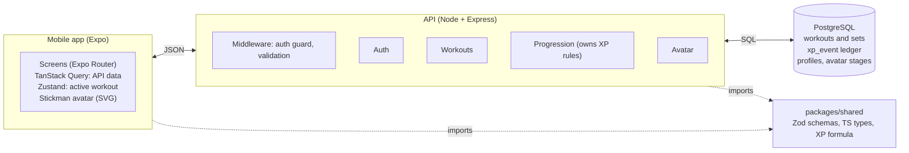

# Level Up — Project Context & Architecture

_Last updated: 2026-11-16 · Source of truth for architecture decisions. Keep this file in sync when decisions change._

## Vision & MVP scope

Level Up is "an RPG that improves your real body": logging real workouts earns XP, XP raises your level, and your avatar visibly grows with you. It is a portfolio project built to production standards, with the goal of launching on the app stores.

**The MVP is one core loop, done well:**

1. Log a workout (exercises, sets, reps, weight).
2. The server awards XP for it.
3. XP raises your level.
4. Your avatar changes as you level up.

**In the MVP:** register and log in, a predefined exercise library, workout logging that tolerates bad gym signal, XP and levels with a weekly consistency streak, a stickman avatar that grows, and a home screen showing avatar, level and XP bar.

**Deferred until the loop works:** custom exercises, cosmetics shop and unlocks beyond growth stages, quests, muscle-group variety bonus, achievements, the rules-based coach, leaderboards, social features, and any AI.

## Working agreement

This project is a learning experience as much as a product. Claude acts as a senior engineer mentoring a junior developer, not as a code generator.

- Explain every architectural decision, and why one option beats another.
- Point out trade-offs; when several good solutions exist, say why one was chosen.
- Explain what each file and class is responsible for, and why it lives where it does.
- Explain framework internals (React Native, Expo, Express, Prisma, Postgres) instead of assuming prior knowledge.
- Follow Clean Architecture, SOLID and single-responsibility where they help; prefer maintainability over cleverness.
- Small, meaningful Git commits; good documentation alongside the code.
- Flag design issues early, and explain the reasoning before changing an agreed design.

## Tech stack

TypeScript runs end to end, so types are shared between the app and the API. This stack replaces the earlier Flutter + Firebase version (paused at Milestone 3, October 2026).

| Layer | Choice | Why |
| --- | --- | --- |
| Mobile app | React Native + Expo + TypeScript | One codebase for iOS and Android; Expo handles builds, store submission and over-the-air updates |
| Navigation | Expo Router | File-based routes, auth-guarded route groups, deep linking |
| Server data | TanStack Query | Caching, retries and refetching for API data |
| Local UI state | Zustand (persisted to `expo-sqlite/kv-store`) | Holds the in-progress workout and the outbox of finished workouts on the device |
| API | Node.js + Express + TypeScript | Own backend; the service layer owns all workout, XP and level rules |
| Validation | Zod (shared) | One schema validates requests on the server and forms in the app |
| Database | PostgreSQL + Prisma | Relational data fits workouts and sets; Prisma gives typed queries and migrations |
| Auth | Better Auth (library inside our API) | Proven password and session handling without vendor lock-in |
| Local dev | Docker Compose | Runs Postgres locally the same way every time |
| Tooling | VS Code, Git, GitHub, MacBook Air M3 | |

## Architecture principles

Six rules keep the app simple today and launchable later. Each one is recorded with its trade-off in the decision log.



The Progression module is the only place XP is calculated; the app and API share types and the level formula through `packages/shared`.

1. **Modular monolith.** One API, split into modules (auth, users, exercises, routines, workouts, progression, avatar). Each module owns its routes, service and data access. Modules talk through service functions, never each other's tables. One Node server plus Postgres can serve tens of thousands of users; a module can be split out later if it ever needs to be.
2. **The server owns the game rules.** The app sends what was lifted, never how much XP to award. This blocks cheating before leaderboards exist, and lets us rebalance progression without an app update.
3. **XP is a ledger.** Every XP gain is its own row. Total XP is the sum; level is calculated from total XP. A cached total on the user keeps reads fast, but the ledger is the source of truth.
4. **Offline-tolerant logging.** The in-progress workout lives on the phone. "Finish" sends the whole workout in one request with a client-generated ID (`clientId`, unique per user), so a retry on bad signal cannot count the workout twice (an idempotent request): the first call returns 201, any repeat returns 200 with the workout already saved.
5. **Proven auth, not home-made.** Better Auth handles password hashing, sessions and resets inside our own API.
6. **Cosmetics are data, not code.** Avatar stages and items live in the database with their unlock rules, so new content needs no app release.

Each API module follows the same layering: route → controller (HTTP in/out) → service (business rules) → repository (Prisma queries) → Postgres. Controllers never hold rules; services never know about HTTP.

Module dependencies point one way: **workouts → exercises, routines, users, progression**, and **progression → users**; nothing depends back on workouts. Finish writes through several modules in one transaction: each repository function that takes part accepts a `db` argument (`lib/prisma` `Db`), and the workouts service passes the transaction client (a "unit of work"). Modules own data and rules, not URL prefixes: `/exercises/:id/summary` and `/exercises/recent` are built from workout history, so they live in the workouts module. Services report expected failures by throwing an `AppError` with a domain `kind` (`not_found`, `conflict`) and a stable `code` (e.g. `UsernameTaken`); the one error handler maps it to a status code, and every error response has the shape `{ error, message, issues? }`. Request bodies are checked by a `validateBody(schema)` middleware using the shared Zod schemas.

## Repository structure

One monorepo holds the app, the API and the shared types, managed with pnpm workspaces. A change to an API contract and the app code that uses it land in the same commit.

```text
Level-UP/
├── apps/
│   ├── mobile/                 # Expo app
│   │   └── src/
│   │       ├── app/            # Expo Router screens: sign-in, sign-up, (app)/ behind the auth guard
│   │       ├── components/     # reusable UI (Button, Card, SetRow, Avatar)
│   │       ├── features/       # auth, profile, exercises, routines, workouts, progress; avatar later
│   │       ├── theme/          # tokens, fonts, contrast checks
│   │       ├── lib/            # API client, query client, storage
│   │       └── stores/         # Zustand stores (active workout)
│   ├── admin/                  # admin web app (after beta)
│   └── api/                    # Express API
│       ├── prisma/schema.prisma
│       └── src/
│           ├── modules/        # health, users, exercises, routines, workouts, progression; avatar later
│           ├── lib/            # Better Auth setup, Prisma client, errors, clock
│           ├── middleware/     # auth guard, error handler, request validation
│           ├── config/         # env loading and checks
│           └── app.ts
├── packages/
│   └── shared/                 # Zod schemas, TS types, XP formula
├── docs/                       # Architecture, Decisions, Roadmap, DevelopmentJournal
├── docker-compose.yml          # local Postgres
├── .github/workflows/          # CI
├── CLAUDE.md                   # context for Claude in VS Code
└── README.md
```

The XP-to-level formula lives in `packages/shared`, but only the server uses it to decide levels: the API sends each player's level, XP into the level and XP needed for the next one, and the app just draws them. So the curve can be rebalanced without an app update (from Milestone 5; before that the app ran the formula itself).

## Initial data model

These tables cover the MVP. Better Auth creates and owns its own user, session and account tables; our `profile` table extends that user with game data.

| Table | Key fields | Purpose |
| --- | --- | --- |
| profile | user_id, username (citext: unique ignoring case), total_xp (cached), weight_unit (kg or lb), time_zone (IANA, from the phone), created_at (sign-up: decides the warm-up week) | Game identity for each user |
| bodyweight_entry | id, user_id, kg (3 decimals), measured_on (date), received_at (server time of the last write, Milestone 5) | Bodyweight history. XP uses the entry in effect on the workout's date (75 kg fallback when there is none), limited by the XP bodyweight rule. The current weight per day (one row per date): what the player sees, and what PRs and volume use |
| bodyweight_receipt | id, user_id, kg, measured_on, received_at | Every bodyweight write the server received, append-only (never updated or deleted), like `xp_event`. The XP bodyweight rule walks these, ordered and timed by `received_at`; each date's latest receipt is that date's entry |
| exercise | id, slug, name, muscle_group, body_part, equipment, mechanic (compound or isolation), reps_unit (reps or seconds), suggested_rest_sec, load_factor, bodyweight_ratio, max_plausible_weight_kg, max_plausible_reps (both nullable: null = the equipment × mechanic default), is_custom, owner_id | Predefined library (seeded from `exercise-catalog.ts`, upserted by slug); custom exercises via owner_id. Tuning values are sent to the app for display; the server recomputes |
| exercise_preference | user_id, exercise_id, rest_sec | The player's own choices per exercise (rest time first). Highest priority: preference > routine > exercise suggestion > 120 s |
| routine | id, user_id, name, created_at, updated_at | A saved plan |
| routine_exercise | id, routine_id, exercise_id, order, target_sets, target_reps, rest_sec | The plan's exercises. A workout COPIES these when it starts, so editing a routine never changes history |
| workout | id, user_id, client_id (unique per user), routine_id (optional link; cleared if the routine is deleted), name, started_at, finished_at, xp_held_back, xp_held_back_reason (daily_cap or too_old) | One gym session; client_id makes "Finish" safe to retry. History is ordered by started_at. The held-back pair records the set XP the workout didn't get and why (stored, because the cap's result depends on what else arrived that day); a CHECK constraint keeps it consistent (0 ⇔ no reason, never negative) |
| workout_exercise | id, workout_id, exercise_id, order, rest_sec | Which exercises were done, in order (exercises in history can't be deleted) |
| workout_set | id, workout_exercise_id, reps, weight_kg (3 decimals), set_order, completed_at, is_flagged, flag_reason, xp_tag | Each set performed. weight_kg is per dumbbell for dumbbell lifts and added weight for bodyweight exercises; timed exercises (plank) log seconds in reps, up to 600 (`HOLD_MAX_SEC`; reps exercises up to 100, `REPS_MAX`). Finish writes is_flagged (implausible: 0 XP, not a PR), flag_reason (a `FLAG_REASONS` code, including above_history) and xp_tag (a `SET_TAGS` code: the label next to the set's XP) from the shared scoring; codes, not database enums, so a new one needs no migration. Stored rather than recomputed so the summary always explains the XP the ledger recorded, even after an earlier workout syncs late or a bodyweight entry changes |
| xp_event | id, user_id, amount, source, source_id, body_part, earned_on (local date), created_at | The XP ledger: one row per XP gain (one per completed set for workout XP). Unique on (source, source_id), so a repeated request can never award XP twice. `earned_on` is the local calendar day the workout STARTED (set XP; the daily cap's day), or for a bonus the local start day of the workout that met the goal (`weekly_goal.met_by_workout_id`), else the week's Monday; `created_at` is only when the server received it. Indexed on (user_id, earned_on). Added in Milestone 5 with a backfill from each row's workout or week, tested against the shared `localDate` |
| weekly_goal | id, user_id, week_start (local Monday), kind (goal or warm_up), target, days_trained, met, streak_after, met_by_workout_id, closed_at | One row per player per week, created lazily (no cron job). Unique on (user_id, week_start). Bonuses use its id as the ledger source_id |
| user_achievement | user_id, key (e.g. streak_12), source_id, awarded_at | Badges, awarded once each (primary key user_id + key) |
| avatar_stage | level_required, name, asset_key | Stages of the avatar (the extras each level unlocks), stored as data. A player's stage is derived from their level, never stored on the profile (Milestone 6) |
| cosmetic | id, slot, name, unlock_rule | Later: unlockable items (hair, outfit, pose) |

**XP source:** effort. Until Milestone 5 workout XP was volume (sets × reps × weight); from Milestone 5 each set earns XP for how strong an effort it was: its estimated 1RM, weighted by how close to failure it was (see "XP per completed set"), plus a flat bonus for meeting the weekly goal and bigger ones at streak milestones. So no exercise is penalised for its natural load, each set uses an effective load: weight + (bodyweight × the exercise's bodyweight_ratio), multiplied by the exercise's load_factor. A push-up counts part of your bodyweight, a pull-up counts all of it, and a light isolation lift like a lateral raise gets a higher load_factor so a hard set earns about as much as a hard squat set. Both values are tuned per exercise in the database. The load is also relative to bodyweight (softened with a square root). Later, training several muscle groups earns more than repeating one.

## XP & level system

Level is never stored as truth: it is calculated from total XP, so the curve can be rebalanced at any time. Each level takes a little longer than the last. The first curve, 100 × (n − 1)^1.5 (level 20 at about 8,300 XP), was replaced in Milestone 5 (decided 2026-11-16, implemented 2026-11-17 as `LEVEL_CURVE` in `packages/shared/src/index.ts`): real sessions earn about 1,500 XP, so it reached level 20 in under two weeks. The curve is:

```
XP to reach level n = 400 × (n − 1)^2.15
```

Level 2 at 400 XP, level 5 at about 7,900, level 10 at about 45,000, level 20 at about 225,000. 1,000 × (n − 1)^1.85 was considered first, but its level 2 (1,000 XP) is out of reach in a beginner's first session (about 500 XP); 400 × (n − 1)^2.15 gives every player a level-up on their first workout and the same pace after that. With formula C, the weekly goal and bonuses below and the 3,100 daily limit, the committed simulation gives (time to level 5 / 10 / 20): intermediate 3×/week 2 wk / 9 wk / 43 wk; light 60 kg lifter 2 wk / 11 wk / 49 wk; bodyweight-only 2 wk / 10 wk / 46 wk; advanced 4×/week 4 days / 4 wk / 20 wk; beginner 2×/week, and the 110 kg heavy beginner alike, 5 wk / 25 wk / over 2 years (level 15 at about a year). Every player levels up on their first workout. The avatar stage levels (5, 10, 15, 20) stay: for the most common player they land at about 2 weeks, 2 months, 5 months and 10 months.

- **Where XP comes from:** workout volume plus the weekly goal and streak milestones (MVP); muscle-group variety, quests and achievements later, each as a new `source` in the ledger.
- **Weekly goal** (all values in `WEEKLY_GOAL`, `packages/shared/src/weekly-goal.ts`): everyone starts at 2 training days a week. From Milestone 5 the goal **rises only when the player beats it**: more days than the target → next week +1 (max 4), exactly the target → unchanged, fewer → −1 (min 2). (Until then, meeting it exactly also raised it, so a steady 3-day player was pushed to 4, missed, dropped back, and lost their streak every other week.) A training day is a workout that qualifies (`qualifiesAsTrainingDay`, the one place the rule lives): at least **3 sets that count**, meaning not tagged warm-up or easy set, not flagged and not beyond the 10-set limit (jump-capped and time-capped sets count), so 3 empty-bar warm-ups or a 1-set workout earn their XP but don't make a training day. The exception is a baseline session (no 12-week best for the exercise, e.g. a player's very first squat session): with nothing to measure effort against, light sets are working sets and do count. No minimum duration: people often tick their sets after training. It is counted once per local calendar day, by the day the workout started. Weeks run Monday to Sunday in the player's time zone. Meeting the goal pays a flat +400 XP at once (mid-week), once per week (+60 before Milestone 5: negligible next to a ~1,500 XP session; +400 is about one beginner session). The week of sign-up is a warm-up (set XP only, no bonus, no streak, target unchanged) unless sign-up was on its Monday.
- **Streak:** consecutive weeks with the goal met; a missed week resets it to 0. Milestones pay +3,000 (12 weeks), +7,500 (26) and +20,000 (52) every time they're reached, also after a reset (+500 / +1,200 / +3,000 before Milestone 5; the 52-week bonus is now about 4.5 weeks of an intermediate player's training). Bonuses make up about 10-12% of a regular player's XP and about a third of a beginner's, on purpose: early on, showing up is what counts; the badge is awarded once. Weekly and streak bonuses are outside the daily XP cap. A future "rest week" pass is one more week kind that pauses target and streak, like the warm-up.
- **Rollover is lazy:** `GET /weekly-goal` (opening the app) and Finish close every week that ended since the last visit, in order, then open the current one. The app waits until its outbox is empty before asking, because a closed week is final: a workout that arrives after its week closed earns set XP only.
- **XP per completed set** (Milestone 5, "formula C"; `setXp` in `packages/shared/src/progression.ts`, the session rules in `set-scoring.ts`):
  - **Reps exercises:** round(0.73 × estimated 1RM of the XP load × effort). Estimated 1RM by Epley at any rep count (a single is the weight lifted).
  - **Timed exercises** (no 1RM to estimate): round(seconds × XP load / 10), counting at most **120 seconds** per set (a longer hold is tagged "Counted to 2:00"). A 60-second plank earns about what a hard set does; a 10-minute one no longer earns nine sets' worth.
  - **XP load** = effective kg × √(75 / bodyweight), where effective kg = (kg + bodyweight × `bodyweight_ratio`) × `load_factor` and the bodyweight is the XP bodyweight (below), clamped to 40-200 kg. A 0 kg pull-up still earns XP.
  - **Effort** (0 to 1, `setEffort`) = reps done ÷ reps the player could have done at that weight, from their best estimated 1RM (real lifted kg), where a set **within 3 reps of failure counts as 1**. The reference is the higher of the player's best for that exercise in the **last 12 weeks** (`recentBest`, `SET_XP.effortWindowDays` = 84) and **the best set so far this session** (that set included), so a set's score **looks back only**: it never changes when a later set is done. The exception is a **baseline session**, one with no 12-week best (the exercise's first, or the first after 12 weeks off; `isBaselineSession`): there the reference is the whole session's best, because nothing else tells a warm-up from a working set, and earlier sets are re-scored as heavier ones follow. A **jump-capped set** (`above_history`) is never a reference: it isn't in the 12-week best, doesn't raise the reference later in its session, and isn't the heaviest set of a baseline session, so one mistyped set (80 kg dumbbells for 50) can't turn 12 weeks of honest sets into warm-ups and easy sets. So a working set 2 reps short of failure earns in full, a warm-up single at half your max earns about 3% of it, and a player back after a long break or an injury, at lower strength, earns full XP for honest hard sets (the window forgets their old best). Strength mostly holds for about 3 weeks without training and drops noticeably by 8-12, so 12 weeks keeps a normal deload or a bad day from resetting it; a short window can't be exploited, because effort never exceeds 1.
  - **The scale 0.73** makes an intermediate player's normal session earn what it did under the old reps × load (the daily cap and level curve stay valid). Simulation: the same strength at 5, 10, 20 and 30 reps earns 1,056 / 1,044 / 996 / 1,044 XP for 12 sets (the old formula: 604 / 1,044 / 1,592 / 2,080).
  - **Why estimated 1RM, and why effort:** reps × load paid a 30-rep set at 50% of your max three times as much as a heavy set of 5 at 87%, for the same hard effort. Estimated 1RM rates both as about your 1RM, but on its own it would pay a single at half your max half a hard set: 60 singles in 30 minutes would earn a full day's cap, and logged warm-ups would add about 75% to a session. Effort makes warm-ups, easy sets and farming nearly worthless (60 easy singles: 60 XP).
  - **Why √(75 / bodyweight):** the plain 75 / bodyweight treated a 60 kg lifter fairly but left a 110 kg beginner (weak for their size) 18% behind a 75 kg one, hit twice; never letting the factor drop below 1 rewarded being heavy (a 100 kg advanced lifter was capped every session). The square root splits the difference: the 110 kg beginner levels like the 75 kg one, a 60 kg lifter levels about 12% slower than an 80 kg one, and a fake low bodyweight pays about half as much (40 kg typed: × 1.37 instead of × 1.88). A pure bodyweight exercise now earns a little more for a heavier player.
  - **Per session, per exercise** (`scoreSessionSets`, the one pipeline the server, the app's live preview and the simulation all run), each exercise's sets in the order they were ticked (`completedAt`, sent with every set by the app; the order logged if any set lacks one): plausibility flags; the jump cap; effort; tags; then only the **first 10 non-warm-up sets** of an exercise earn XP. The count is per exercise across the whole session (the same exercise twice, e.g. in a superset, shares one count); warm-ups (at most 5 per exercise, `MAX_WARM_UPS_PER_EXERCISE`) don't count toward it; easy sets do. A set beyond the 10 earns 0 and is tagged "Beyond 10 sets". No honest simulated player does more than 5 sets of one exercise; the rule cuts a 60-sets-a-day player from 2.4× to 1.7× an honest intermediate's XP and a farming account from 2,520 to 420 XP a day.
  - **Tags** (`setTagText`), shown after a set's XP in the live view and the summary: "Warm-up" (effort below 0.5 before any working set, or before the heaviest set in a baseline session; at most 5), "Easy set" (effort below 0.5 otherwise), "Counted to 2:00", "Above your best · +25%" (jump cap; explained by one fixed sentence, `JUMP_CAP_TEXT`: "More than 25% above your best, so it earned XP as if at that limit." No baseline number: the summary doesn't send it, and "your best" is the jump baseline, which remembers older bests than the 12-week window), "Check this set" (implausible), "Beyond 10 sets". Sets between 0.5 and 1 effort get no tag (the lower XP number is enough). The daily cap is one line in the summary, not a tag.
  - **Live XP offline:** effort and the jump cap need the player's history, so the API sends each exercise's 12-week best and jump baseline on `GET /v1/exercises/xp-history` (since 2026-11-18 also the daily cap's values and the player's local today: set XP already awarded and the `clientId`s of the workouts that started that day), and the XP bodyweight on `/v1/profile` (`xpBodyweightKg`). The app saves both on the phone per player (the profile too since Phase 4b). It never edits its copy of the history: the history the preview uses is the server's copy plus the player's workouts still pending in the outbox, replayed in outbox order through the same shared scoring (`effectiveXpHistory`). So a second offline workout previews against the first one's bests, a workout the server rejects ("needs attention") drops out at once (and the copy is refetched), and only the signed-in player's workouts are replayed. When a workout reaches the server, it leaves the outbox and the copy is refetched. The daily cap only appears once the server answers (another phone may have synced that day).
  - They are worked out from logged sets on every request, with the same function Finish uses (`progression.xpHistories`): no stored copy to keep in step. The cost grows with history, so a performance test seeds two years of a dedicated player (416 workouts, about 10,000 sets, 20 exercises) and holds `GET /v1/exercises/xp-history` and Finish under 400 ms and the exercise list under 150 ms (measured: about 50-70 ms and 3 ms). **If that budget is exceeded, the planned next step is a stored row per player and exercise (best, baseline), updated at Finish.**
  - **Anti-cheat:** entering a low bodyweight would inflate barbell XP (an 80 kg lifter claiming 40 kg would double it). So XP uses an **XP bodyweight**: the recorded history, walked in the order the server received the entries, where each new entry can move the value, in either direction, by at most 2% per week of time since the previous entry, and the result is clamped to 40-200 kg. Increases were briefly left unlimited (a higher bodyweight used to earn less or the same); under the square-root scaling a higher typed bodyweight earns more on pure bodyweight exercises (a 75 kg player typing 200 kg would get × 1.63 on pull-ups), so since 2026-11-17 increases are limited too. Honest bulking (0.25-0.5% a week) is far inside the limit; a too-low typo corrected upwards lags, which costs that player XP rather than giving any. The allowance builds up with time, not per entry, so infrequent updates are fine: 5 kg lost over two months and entered once moves fully (an 80 kg player has about 13 kg of allowance after 8 weeks), and so does 10 kg lost during a year away. Only change that is faster than about 2% a week lags, and it catches up over the following weeks. A fake overnight drop takes months to pay off.
  - The walk runs over every bodyweight write the server ever received (`bodyweight_receipt`, append-only), in the order and at the times the SERVER received them (`received_at`), not the date the player typed (`measured_on`). Re-entering a date replaces that day's entry but adds a receipt, so an edit can't erase the history the limit is measured against: re-entering every date (the reset trick found in Phase 3) still leaves the original receipts in the walk, and only the first receipt is taken as typed, plus every receipt in the **first week after sign-up** (`BODYWEIGHT_XP.graceDays`, from `profile.created_at`): a new player who mistypes their first weight (120 instead of 80) can correct it at once instead of over about 20 weeks, and the limit starts from the latest receipt of that week. A backdated entry gets no allowance. A typo corrected minutes later counts as a change too, and catches up within the allowance (about a week for a 2 kg correction). `measured_on` only decides which entries are in effect for an older workout. It is a pure function over the bodyweight history in `packages/shared` (`BODYWEIGHT_XP.maxChangePerWeek`), tested and included in the simulation.
  - The app still shows and stores the bodyweight the player typed; only XP uses the limited value. The first entry is taken as typed (a new account can't be checked against anything). Old workouts keep the value in effect on their date, as before.
  - PRs, estimated 1RM, volume and "BW + x kg" always use real kilograms; the bodyweight factor applies to XP only.
  - Trade-off: a heavier, stronger player earns a little less per kg lifted than an equally strong lighter one. This is one function in `packages/shared`, so it is easy to swap.
- **Personal records** (calculated on read from logged sets): estimated 1RM by Epley, kg × (1 + reps / 30), on lifted kg (logged weight plus the bodyweight share; real kilograms, never XP's scaled load); a single rep counts as the weight lifted. Sets above 12 reps don't count toward estimated-1RM PRs; they are tracked as "most reps at a weight". Timed exercises (plank) use the longest hold. Bodyweight sets are shown as "BW + x kg". Flagged and jump-capped sets are never records, in the Finish summary or the exercise page (`canBeRecord` in `packages/shared`); the exercise's session list still shows them.
- **Coach hint** (fixed rules, no AI): double progression. Raise the weight only when every set hit its target reps last time; the increment is configured per equipment type (default +2.5 kg barbell and machine, +1 kg per dumbbell).
- **Who calculates it:** the progression service on the server (`scoreWorkout`), in the same database transaction that saves the workout. The workouts module loads the player's history with each exercise and passes it in, so progression still never reads workout tables. History is every workout that STARTED before this one, read after the profile lock; an older workout synced late becomes history for the ones after it, but never changes XP already recorded. The app runs the same shared functions only to show live XP, PRs and hints during a workout; the server recomputes and is the only one that awards anything.
- **Where the formula lives:** `packages/shared`, with unit tests. The server is the only one that turns XP into levels; the app shows the level progress the API sends (`level`, `xpIntoLevel`, `xpForNextLevel`). The app still uses the shared set formula for the live XP preview during a workout.
- **Balancing is tested with a simulation, not only unit tests.** A committed script (`packages/shared`, run with one command) prints XP per session, days to the daily cap and time to each level for set player types: beginner, intermediate, advanced, a light lifter (about 60 kg) and a bodyweight-only player. A second table plays the same honest players also logging a warm-up ramp before each barbell lift. It is rerun whenever an XP constant changes, and its output is pasted into the decision-log entry for that change. Real tuning happens in the beta.
- **Level-up moment:** the "Finish workout" response returns XP gained, old level and new level, so the app can play the level-up screen without a second request. Since Phase 3 the summary also carries the level status before and after (`levelStatus`: level, `xpIntoLevel`, `xpForNextLevel`), the XP held back with its reason (`xp.heldBack`: `daily_cap` or `too_old`), and every set's recorded XP, tag and flag reason (`sets`). All new fields are additions: older apps' schemas drop keys they don't know.

**Limits against fake or inflated workouts** (values to tune later):

- **Daily soft cap** (`DAILY_XP_CAP` and `applyDailyCap` in `packages/shared/src/xp-limits.ts`, Phase 1f): full XP up to **3,100** set XP a day, then 25% beyond it, and never more than 6,200 awarded in one day (reached only after about 15,500 XP of raw sets). 3,100 is the smallest limit, in steps of 100, at which no honest simulated player is capped more than 3 days a year (none is capped at all): the biggest honest day is a 100 kg advanced lifter's leg day, 3,014. At 2,500 the advanced players were capped on every leg day or every session. A soft cap rewards a genuinely big day without making a fake 1,000-pull-up day worth it. It covers set XP only (`XP_SOURCES_UNDER_DAILY_CAP`); weekly and streak bonuses are outside it. Sets are capped in the order logged, each taking its full-rate share first, then 25% of the rest (rounded per set, so a set in the band can lose up to half an XP), then stopping at the ceiling; the XP held back is stored on the workout (`xp_held_back`, reason `daily_cap`) and shown in the summary. Live at Finish since Phase 3 (`progression.scoreWorkout`). Three rules keep it honest:
  - **The cap's day is the day the workout started**, in the player's time zone (the same rule as training days), stored on each ledger row as `xp_event.earned_on`. `created_at` is when the server received the row, so an offline workout synced two days late would otherwise count against the wrong day.
  - **Lock, then count.** Finish locks the player's profile row (`SELECT ... FOR UPDATE`, as the weekly rollover does) BEFORE it sums the day's XP and awards more. Without the lock, two Finishes arriving together could each see room under the cap.
  - **Old workouts earn no XP** (`isTooOldForXp`, `XP_MAX_WORKOUT_AGE_DAYS`). `startedAt` comes from the phone, so a cheat could spread fake workouts over past days, each under its own cap. A workout that started more than 14 days before the server received it is still saved (history and PRs), but earns no XP; exactly 14 days still earns. The XP it would have earned is stored as held back with reason `too_old`, and the daily cap isn't applied to it. Future times are already rejected by the shared schema.
- **Plausibility checks per set:** reps or weight far beyond a realistic range for that exercise earn no XP and are flagged instead of rejected, so honest typos can be fixed. The rules (Phase 1d, `packages/shared/src/xp-limits.ts`):
  - Limits are on the LOGGED weight (per dumbbell; ADDED weight for bodyweight exercises) and the reps. A set over either is flagged with `flag_reason` `weight_above_range` or `reps_above_range` (weight wins if both), saved, earns 0 XP and isn't a PR. Only the code is stored; the summary builds the sentence, with the limit, in the player's unit.
  - Each exercise can override its weight and reps limits (`max_plausible_weight_kg`, `max_plausible_reps` on `exercise`, sent to the app on the exercise list); otherwise the default for its equipment × mechanic applies, which is also what custom exercises use. Catalog overrides, where a strong honest lifter can pass the default: back squat 450 kg, deadlift 450, leg press 500, standing calf raise 300, one-arm dumbbell row 100 (per dumbbell). Timed exercises are never flagged for duration (their limit is the hard 600 s).
  - Defaults, around elite level so a strong honest lifter is never flagged (weight kg / reps): barbell compound 350 / 50, isolation 120 / 60; dumbbell compound 80 / 60, isolation 50 / 60; machine compound 300 / 60, isolation 200 / 60; cable compound 200 / 60, isolation 120 / 60; kettlebell compound 100 / 100, isolation 48 / 60; bodyweight (added) compound 100 / 100, isolation 50 / 100. The simulation checks that none of its honest players is ever flagged.
  - Status: since Phase 3, Finish runs `scoreSessionSets` before saving and stores each set's `is_flagged`, `flag_reason` and `xp_tag`; flagged sets earn nothing and aren't PRs. Timed exercises have their own maximum, `HOLD_MAX_SEC` = 600 s, separate from `REPS_MAX` = 100 (done in Phase 1c). Schemas that can't see the exercise (a Finish set, a routine target) allow up to 600; the server then checks each set against its exercise's limit (`RepsOutOfRange`, 400), and the app checks it while the player types.
- **Jumps against the player's own history** (Milestone 5, Phase 1e, `xp-limits.ts`): a set far above the player's best for that exercise earns XP as if it were exactly at the 25% line (its XP × line ÷ its value), is marked (`flag_reason` above_history; not `is_flagged`, because it still earns capped XP) and isn't a PR. What's compared:
  - **Reps exercises, at every rep count:** estimated 1RM by Epley, lifted kg × (1 + reps / 30), against the player's best estimated 1RM. So 60 kg × 8 last week and 60 kg × 80 this week is caught (76 → 220 kg "estimated"), while an honest switch of rep range isn't: a best of 100 kg × 5 (about 117 kg) followed by 60 kg × 20 (100 kg) is below the best. Single-set volume above 12 reps was considered first and rejected: that same 60 kg × 20 has 2.4 times the volume of 100 kg × 5, so volume would cap an honest change of rep range. The rule that sets above 12 reps don't count applies to PR display only.
  - **Timed exercises:** seconds held against the longest hold.
  - **The baseline is fixed for the whole session** (the best from earlier sessions), so a cheat can't climb 25% per set. After the session it moves to the session's best, but no higher than the line: a lifter who really got stronger catches up within a few sessions (60 → 100 kg is capped twice, then full XP), while a cheat gains at most 25% per session, still inside the daily cap and the absolute limits.
  - It is replayed from the player's history at Finish (the same history PRs already load), so it needs no column of its own. Implausible (`is_flagged`) sets are left out of both sides. Jump-capped sets count toward the baseline at the line, and not at all toward effort's 12-week best (the replay finds them again, so no stored tag is needed).
  - The first session of an exercise (or a best of 0) has nothing to compare with, so only the absolute limits apply.
  - The simulation checks that no honest player is ever capped, including a "rep-range switcher" who rotates 5 / 10 / 20 / 30-rep days at loads from a standard %1RM table: Epley stays within a few percent of that table up to 30 reps.
  - The 25% (`JUMP_CAP.maxJump`) is a constant in `xp-limits.ts`, tuned with the simulation and the beta. Retuning changes future workouts only; XP already in the ledger is final.
- **Special events later:** marathons and other big efforts get their own XP source with its own limits, rather than raising the daily cap for everyone.
- **Server-side only:** all caps run in the progression service, so they can be tuned without an app update.

## Avatar prototype: a stickman that grows

The first avatar is a stickman drawn in code with `react-native-svg`. No art assets are needed, and growth is just numbers: limb thickness, shoulder width and head size change with the stage. Later we can swap the renderer for layered 2D art (and possibly 3D after that) without changing the data model.

**Each body part grows on its own.** Every exercise belongs to a body part (chest, back, shoulders, arms, core, legs), and its XP also counts toward that part. Skip leg day and the stickman's legs stay thin while the arms grow.

**Level unlocks, body-part XP shapes** (decided 2026-11-16). The two never mix:

- **Overall level** (from total XP) unlocks things: stages, titles, cosmetics, the headband, the cape, the glow. It never makes a limb bigger.
- **Body shape** comes only from body-part XP. A player who only trains upper body has a high level, a cape and thin legs.
- **Untrained parts shrink slowly.** After a two-week grace period, a body part's development declines slowly, so a few weeks off cost a little and only about a year without training brings it back to the starting shape. XP and level are never lost; only the shape changes. Calculated on read from the ledger's dates (no scheduled job), like the weekly goal. The exact decay curve is set in Milestone 6 with the simulation.
- **Starting shape (open, decided in Milestone 6):** an experienced lifter shouldn't start as a thin stickman. Proposal: calibrate the starting shape from the first two weeks of logged lifts relative to bodyweight, rather than a self-reported baseline, which anyone could exaggerate. Either way it sets the starting shape only; everyone starts at level 1.

- Body-part XP is tracked in the ledger (`xp_event.body_part`, with `earned_on` as its date), so it can be rebalanced like overall XP. Shrinking needs to know WHEN each part was trained, so a plain total per part isn't enough: development is calculated from the dated rows, and any cache holds the value plus the date it was last trained (Milestone 6).
- The avatar takes one development value per body part (for example 0 to 1) and draws each limb from it. The same values will drive the layered 2D or 3D art later.
- To encourage balanced training, the home screen points out the weakest body part, and the later variety bonus gives extra XP for training neglected parts.

| Stage | Unlocks at | Look |
| --- | --- | --- |
| Rookie | Level 1 | Plain stickman |
| Regular | Level 5 | Wristbands and a title |
| Athlete | Level 10 | Sports outfit |
| Champion | Level 15 | Headband |
| Legend | Level 20 | Cape and a glow |

Stages add extras only; limb size, shoulder width and chest come from body-part development. Stage levels are rechecked against the new level curve in Milestone 5.

- The `Avatar` component takes a stage config (extras) and one development value per body part, never a level, so the art and the rules stay separate.
- Stage thresholds live in the `avatar_stage` table and can be tuned without a release.
- A small growth animation plays on the level-up screen when the stage changes.

## Production readiness plan

These are designed in from day one but switched on when the milestone needs them, so none of them slows down the first build.

| Concern | Approach | When |
| --- | --- | --- |
| Code quality | ESLint, Prettier, strict TypeScript | Milestone 1.5 |
| CI | GitHub Actions: type check, lint and tests on every push | Milestone 1.5 |
| Pre-commit hook | `simple-git-hooks` runs `pnpm typecheck && pnpm lint` before every commit (installed by the root `prepare` script on `pnpm install`). Tests stay in CI and `pnpm check`: they need Docker Postgres. Lint covers every package: the mobile app with Expo's config, the API and shared with the root `eslint.config.mjs` (`typescript-eslint` recommended, not type-aware: the API is on TypeScript 7) | Milestone 5 |
| Tests | Vitest unit tests for pure logic (XP formula, shared schemas); Jest (`jest-expo`, as Expo recommends) for the app's workout and outbox logic; API integration tests with Supertest against a real Postgres test database (`levelup_test`, wiped before each test; CI uses a Postgres service container) | From Milestone 2 |
| Config and secrets | `.env` files validated at startup with Zod; never committed | Milestone 1.5 |
| Errors and crashes | Sentry in the app and the API | Before beta |
| Hosting | API in a Docker container on a managed host; managed Postgres with backups | Before beta |
| App builds | Expo EAS builds, store submission, over-the-air updates | Before beta |
| Security | Helmet headers, input validation on every route | Milestone 2 onwards |
| Rate limiting | Better Auth's own limiter on `/api/auth`; a limiter on our routes (per user, stricter on writes). Needs `trust proxy` set correctly once the API sits behind the host's proxy | Before beta |
| API versioning | Our routes live under `/v1`; `/api/auth` and `/health` stay unversioned. Old app versions stay on phones for months, so a breaking change becomes `/v2` next to `/v1` | Before Milestone 5 |
| Password reset and email verification | Better Auth's reset and verification flows, with a transactional email provider (still to choose) | Before beta |
| Account deletion | `DELETE /v1/me`, asking for the password again. Every table cascades from `user`, so one delete removes everything. Required by the App Store and Google Play | Before beta |
| Privacy | Privacy policy and store data-safety forms (bodyweight and training history are personal data: POPIA, GDPR) | Before beta |
| Minimum age | Minimum age at sign-up (13 or 16, to be decided) with an age check, and the app store age rating. The XP and bodyweight rules are designed for adults and older teens | Before beta |
| Analytics and admin | A read-only reporting user on Postgres and a hosted chart tool (e.g. Metabase) with saved queries; dashboards show aggregates, not individual players' workouts. A custom `admin` module and `apps/admin` web app after the beta | Before beta (chart tool); after beta (custom admin) |
| Local test files | curl cookie jars and other scratch files are git-ignored (`cookies.txt`), never committed | Now |

The hosting provider is still open; the shortlist is Render, Railway or Fly.io for the API, and Neon or Supabase for Postgres.

## Roadmap & milestones

Each milestone ends in something that runs end to end on a phone, not a pile of half-built layers.

1. **Design the core screens.** Mock up avatar creation, home (avatar + level + XP bar), log workout, and the level-up moment.
   - Done when: the four screens are agreed and the data each one needs is listed.
2. **Foundation.** Monorepo, Docker Postgres, Prisma, Express API, Expo app, lint and CI.
   - Done when: the phone calls `GET /health`, the API reads from Postgres, and CI is green.
3. **Authentication.** Register, log in, log out, session kept across restarts, profile created on sign-up.
   - Done when: a new user signs up on the phone and lands on an auth-guarded home screen.
4. **Workout logging.** Exercise library, start a workout, add sets offline, finish with a safe retry.
   - Done when: a workout logged in airplane mode saves exactly once after reconnecting.
4c. **Routines and active workout.** Saved routines (list, detail, builder), the active workout screen with a rest timer and notification, estimated 1RM and PRs, XP per set written to the ledger, the workout summary and exercise history. Pulls the XP ledger and PRs forward from Milestone 5.
   - Done when: starting a routine pre-fills the active workout, the rest timer is correct after the app was in the background, and Finish shows XP earned and new PRs, saved exactly once.
5. **Progression.** Level-up screen, XP relative to bodyweight, a stretched level curve with rescaled weekly and streak bonuses, the API sending level progress, the balancing simulation, daily XP cap (`xp_event.earned_on`, lock-then-count, no XP for workouts older than 14 days), per-exercise plausibility flags and the jump cap against the player's history (the ledger, level formula and XP bar arrive in 4c; the weekly goal and streak arrived before 4c Phase 4). Before it starts: routes move under `/v1`.
   - Done when: finishing a workout shows XP gained and, when earned, a level-up; two Finishes sent at the same moment can't exceed the cap; an offline workout synced days later counts against the day it was done.
6. **Stickman avatar.** Stage extras driven by level, body shape driven only by body-part XP, slow shrinking of untrained parts, and the starting-shape decision.
   - Done when: the avatar gains its extras at each stage level, untrained body parts stay thin whatever the level, and a part untrained for months visibly shrinks.
   - Leave room for endurance: the avatar design must allow an endurance look (a stamina stat, a lean athletic build) next to muscle size, so a runner's or triathlete's avatar looks different from a lifter's rather than just weaker. No endurance code in this milestone; the design and data shapes just mustn't rule it out.
7. **Beta readiness.** Hosting, Sentry, EAS builds, password reset and email verification, account deletion, rate limiting on our routes, privacy policy, minimum age at sign-up (13 or 16, to be decided) with an age check and the app store age rating, testers on TestFlight and Google Play internal testing. The XP and bodyweight rules are designed for adults and older teens. Review the daily cap against the testers' real days: in the simulation the biggest honest day with warm-ups logged is 3,086 against the 3,100 cap, a 14 XP margin.
   - Admin view, built from ready-made tools (no app code):
     - a read-only Postgres user for reporting, with no write access to the main database;
     - a hosted chart tool (e.g. Metabase) on that read-only user, with saved queries for: sign-ups per day and week, active players (a workout in the last 7 / 30 days), first workout finished after sign-up, week-2 return, weekly goal met, XP per workout, daily cap hits, and level spread;
     - optionally, product analytics events from the app (e.g. PostHog) for sign-up and first-workout drop-off.
   - **Edit or delete a set or a whole workout in a finished workout.** Beta testers will mistype, and a mistype in an exercise's first session (nothing to jump-cap against) or one under +25% otherwise sets the effort reference for 12 weeks. The design:
     - **API:** `PUT /v1/workouts/:id/sets` replaces the workout's sets in one go; `DELETE /v1/workouts/:id` removes the workout. Each request carries the workout's `revision` (a new column), so two phones editing at once get a 409 instead of overwriting each other. Online only at first: no outbox for edits.
     - **Re-score only the edited workout**, with exactly the inputs it had: the history before it, the XP bodyweight on its date, and the other XP of its day (the daily cap). The same plausibility limits, jump cap and daily cap apply, so an edit never earns more than logging it right would have. Future workouts need nothing: the 12-week best, the jump baseline and PRs are rebuilt from the saved sets at every Finish, so correcting the sets corrects them.
     - **The ledger stays append-only:** a correction is new `xp_event` rows (source `correction`) with the signed difference per body part, never an update. `(source, source_id)` is unique, so each row's `source_id` is the edit's id plus what it corrects (`editId:chest`, `editId:weekly_goal`); a retried edit can't apply twice. `earned_on` is the workout's day. Total XP, the level and the avatar follow the sum.
     - **The open week is recounted:** an edit or delete in the week that's still open recounts its training days. If the goal is no longer met, the weekly bonus is reversed with a correction row (otherwise logging a fake workout and deleting it after the bonus farms +400 a week); if an edit makes the goal met, the bonus is paid as at Finish. Closed weeks are final, their bonuses and streaks included. "days_trained only ever goes up" stays the rule for time-zone changes, not for edits or deletes.
     - **A correction that lowers XP is always shown**, never a silent drop: "Workout corrected: −120 XP" on the screen where the edit was made, and kept as a line in that workout's details. If it lowers the level or the avatar stage, the notice says so ("Level 6 → 5"). The level can go down: clamping it would break "level is derived from total XP", and the last celebrated level means no second celebration on the way back up.
     - **Limits:** sets can be edited within the 14-day XP window; a workout can be deleted any time (that only ever removes XP).
     - **Not re-scored:** later workouts scored against the mistake keep their XP. If the beta shows it matters, re-scoring the exercise's later workouts in the 12-week window can follow, as upward corrections only.
   - Done when: five real people use it at the gym for two weeks, and I can open the dashboard and see sign-ups, active players and daily cap hits from the beta.

Later, not yet scheduled: **session backup sync**, an idempotent `PUT /sessions/:clientId` that uploads the whole in-progress session every minute or so. It protects against a lost phone and gives the server its own receive times, which the anti-cheat checks need (sets far above the player's history, or completed implausibly fast, get `is_flagged`, earn no XP and don't count as PRs until confirmed).

Also later: **confirm a flagged set** (today a flagged set stays flagged; editing one is part of Milestone 7), and **revisit the 14-day XP window and backdating** before leaderboards.

Also later: **content beyond level 20** (further avatar stages, titles, cosmetics). Levels themselves have no maximum: `xpForLevel` and `levelFromXp` have no cap, and nothing in the API, the database or the app assumes 20 is the top (checked 2026-11-16).

**After the beta: a custom admin dashboard**, replacing the ready-made tools of Milestone 7 once we know which numbers we actually use:

- **API:** an `admin` module with read-only endpoints that return aggregates, not raw user rows.
- **Access:** an admin role (Better Auth's admin plugin), strong authentication, and an audit log of admin actions.
- **App:** a small web app in `apps/admin` that reuses the `packages/shared` types.
- **Later admin actions:** a review queue for flagged sets (`is_flagged`), and editing exercise tuning (`load_factor`, `bodyweight_ratio`, rest) without a deploy.

**After the beta: endurance and hybrid training** (running, cycling, swimming, rowing and ski erg, and Hyrox-style stations), so the app works for every kind of athlete, not only lifters. Logging and device import are built together, so watch data is used from day one:

- **Tracking types:** an exercise's `reps_unit` becomes a wider tracking type: reps × weight (today), time (plank), distance + time (run, bike, swim, row, ski erg), distance + weight (sled push and pull, farmers carry, sandbag lunges). Sets get optional distance and duration columns. Hyrox stations map onto these (wall balls are reps; sleds and carries are distance with weight; runs and ergs are distance and time).
- **Endurance XP:** its own formula, since estimated 1RM means nothing for a run: time × effort, where effort compares pace with the player's own recent best (the same 12-week window as lifting) or uses heart-rate zones when that data exists. A slow runner working hard earns as fairly as a fast one. Long efforts (a long ride, a marathon) use the planned special-event XP source with its own limits instead of hitting the daily cap.
- **Avatar:** running and cycling grow legs, swimming grows back and shoulders, and an endurance stat (stamina, a leaner build) sits next to muscle size.
- **Weekly goal:** an endurance session qualifies by duration: about **15 minutes of moving time at above-easy effort** (to be tuned with the simulation), added as its own branch of `qualifiesAsTrainingDay` without touching the weekly-goal code. A mixed session (lifting plus a run, a Hyrox workout) qualifies if either part does.
- **Plausibility:** pace and distance limits per sport.
- **Device import:** Apple Health (iOS) and Health Connect (Android), which most watches already sync into (Garmin, Strava and others), so one integration per platform covers most devices. Needs an Expo development build (native module). Imported workouts are de-duplicated against manually logged ones. Direct Garmin or Strava APIs only if the health stores aren't enough (Garmin's program needs an application and approval).
- **Health stats:** VO2 max, resting heart rate and similar are imported and shown as stats and long-term charts, never calculated by us and never used for XP (device estimates vary and can't be checked).

Then: variety bonus, quests, achievements, the rules-based coach, cosmetics, then leaderboards and social features.

**Competition: avatars in events** (with leaderboards and social features, after Milestone 6 and the endurance milestone, because it needs their stats). Two kinds, both offered:

- **Avatar-stat events, for everyday play:** a powerlifting meet, a race or a Hyrox-style event played out between avatars from their stats, with some luck or strategy so the strongest player doesn't always win. Everyone can take part, beginners included.
- **Real-performance rankings, for bragging rights:** actual best lifts (adjusted for bodyweight with a score such as DOTS, as real powerlifting does) and real race times.
- **Stats:** strength per body part (Milestone 6 development values), endurance (stamina, endurance milestone) and consistency (streak and weekly goal history). Level is not part of event scoring, so long-time players don't automatically beat stronger newer ones.
- **Fairness:** divisions by bodyweight class or a bodyweight-adjusted score, and level brackets so beginners meet beginners. Results are calculated asynchronously at first; real-time head-to-head later, if ever.

**Trust and verification** (decided 2026-11-17). Typed numbers, and numbers typed into a phone's health app, can't be fully verified. The goal is to make cheating not worth it everywhere, and to require proof only where it matters:

1. **Contain it in everyday play:** the daily cap, the jump cap against the player's own history, plausibility limits and the bodyweight rate limit (all from Milestone 5) keep a cheat to slightly faster XP, not dominance.
2. **Trust levels on data:** device-recorded workouts (Apple Health / Health Connect, which record each entry's source and whether it was typed by hand) rank above typed or hand-entered ones; hand-entered health-app data is treated as typed.
3. **Video proof for top positions:** a lift or time only counts toward the top of a real-performance ranking with a short video, reviewed by moderators or other players.
4. **Friends first:** competitions start between friends and groups, where faking is socially costly, before any global ranking.
5. **Luck in avatar events:** mixing stats with chance makes inflated stats win less reliably, so they're less worth faking.
6. **Reporting and review:** players can report suspicious entries; automatic checks (sudden jumps, implausible pace) flag them for review.

**Not used: photo-based checks.** Judging bodies from photos to spot fake lifts was considered and rejected. Appearance predicts strength poorly, so it would accuse honest players; it harms people self-conscious about their bodies; body photos are sensitive personal data (POPIA, GDPR), with more risk where minors are involved; and a borrowed photo defeats it.

After the rules-based coach: **the avatar as a talking AI coach.** Players chat with their character to build plans, check progress or get motivation. It runs on our server (the API key never ships in the app) and uses our own API as its tools (read progress, create a routine); the rules coach's checks become tools it can call. Needs per-user usage limits (every message costs money) and safety guardrails for injury, pain and diet questions before it ships.

## Decision log

Newest first.

| Date | Decision | Trade-off accepted |
| --- | --- | --- |
| 2026-11-20 | The root `typecheck`, `test` and `lint` scripts run with `pnpm -r --no-bail --no-sort`: every package runs to the end and prints its failures in full, in CI and in `pnpm check`. Before, the first failing package stopped the others mid-run (and a failure in `packages/shared` skipped the apps), so a failure message could be cut short | A failing run takes as long as a passing one; packages no longer run in dependency order (none needs it: the apps read `@levelup/shared` from source) |
| 2026-11-20 | Phase 4d: the server's summary. The XP card's headline is "Total XP earned", broken down below into "XP for sets" (labelled as the estimate's headline is, so the two compare) and each bonus (weekly goal, streak) on its own line; the estimate keeps "XP for sets · estimate" as its headline. Revised the same day: set XP was the headline at first. Set XP held back gets its own line (daily limit, or "synced more than 14 days after it started"). The level bar is drawn from the server's `statusBefore` and `statusAfter` only (the phone's level curve is no longer used); a workout that gains more than one level shows "Level 4 → 6" and only the new level's progress. "XP by exercise" lists each exercise's XP and only its tagged sets ("Set 3 · Check this set · 0 XP", in red) | The headline changes meaning when the answer arrives (set XP estimate → total with bonuses), so a goal-meeting workout's big number jumps by the bonus; the "XP for sets" line right below is what to compare with the estimate |
| 2026-11-20 | Phase 4d: the summary's XP before the server answers is the live score **saved at Finish** (finished-workout store v2, `previewFromPayload`): exactly the sets Finish sends (ticked only, after editing ended), scored with the workout's pinned context and the daily cap, in the payload's order, so preview set n is the server's set n. Set XP only, labelled "estimate"; bonuses wait for the server. The level bar adds it as a lighter pending segment on the level status cached at Finish, stopping at the end of the level, and never says "Level up!": only the server's answer does. v1 saves migrate with no estimate rather than the old plain-set-XP one. Also fixed: the summary kept the workout from *before* Finish ended editing (missing a pending edit) and the tap time as the finish time (not the time sent, which differs after 6 hours) | The estimate can still differ from the server (another phone's workout, a changed bodyweight, server-side tuning); the summary explains any gap once the answer arrives. The pending bar uses the level the phone had cached, which leaves out workouts still queued |
| 2026-11-20 | The phone keeps only the LAST finished workout's summary (`levelup.finished-workout`): finishing another, even offline before the first synced, replaces it. The earlier workout still syncs, and its summary is in the history (`GET /workouts/:id/summary`) | Its estimate and the moment its answer arrives are no longer shown; a list of pending summaries isn't worth it for a rare case |
| 2026-11-19 | Planned for Milestone 7: editing and deleting sets or whole finished workouts. Only the edited workout is re-scored, with the inputs it had, and the difference goes into the ledger as `correction` rows (one per body part, `source_id` = edit id + what it corrects). An edit in the open week recounts its training days and reverses the weekly bonus if the goal is no longer met; closed weeks are final. A correction that lowers XP is always shown to the player, including a lower level or avatar stage | Later workouts scored against the mistake aren't re-scored (a full replay would rewrite XP players already saw and ripple into bonuses and other days' caps). A level can go down |
| 2026-11-19 | A jump-capped set (`above_history`) is never a reference for effort: it's left out of the 12-week best (`exerciseXpHistory`, the session summary's `sessionBest`), doesn't raise the reference for later sets in its session, and isn't a baseline session's heaviest set. It still counts toward the jump baseline, at the line. Before, its full typed value became the effort reference: 80 kg dumbbells typed for 50 (× 10) made every honest 50 kg set of the next 12 weeks effort ≈ 0.32, so warm-ups and easy sets, and the session not a training day. Cutting it to the line instead was considered and rejected: still effort ≈ 0.59, 41% less XP for 12 weeks. Simulation rerun: every number unchanged (honest players are never jump-capped; the 200 kg cheat's sets were already at effort 1), biggest honest day still 3,086 | A genuine jump of more than 25% isn't the reference for a session or two, so lighter sets after it score generously (effort errs upward; the jump cap still limits the jump itself). Doesn't fix a mistype in an exercise's first session (nothing to cap against) or one under +25%: those need editing a finished workout (Milestone 7) |
| 2026-11-19 | Tick feedback (`tickFeedback`): every tick and untick is announced to screen readers with the set's XP and the new total ("Set 4 done, plus 85 XP, 115 total. 3 earlier sets now warm-ups."), plus the daily cap line when that tick reached it; earlier rows still update without being announced. In a baseline session the ticked row says what it changed, leading with its gain ("+85 XP · 3 earlier sets now warm-ups", no minus number: the total shows the net change), and the exercise is captioned "First session: this sets your baseline. Earlier sets may be re-scored as warm-ups." (reps exercises only). Contrast: the XP line's muted and red text on the done row pass 4.5:1 in both themes (tested) | A drop is heard on the tick but its size isn't spelled out (the total is). The tick line stays until the next tick in that card |
| 2026-11-19 | An empty weight means 0 kg only on bodyweight exercises (where the weight is what's added). On barbell, dumbbell, machine, cable and kettlebell lifts it's a weight not entered yet: the tick is refused ("Enter the weight."), a done set edited to empty keeps its ticked values with that message, and Finish refuses the workout naming the exercise. A typed "0" is still 0 kg | One more tap for a real 0 kg set (rare on a loaded lift). A never-done loaded exercise shows the "0" placeholder but must have a weight typed before ticking |
| 2026-11-19 | Admin dashboard: ready-made tools on a read-only database user for the beta; a custom admin module and web app only after the beta. Dashboards show aggregates, not individual players' workouts (POPIA/GDPR); a privacy policy describing what's collected is required before store submission | Less polished and no admin actions during the beta; no code to build or secure until we know which numbers we actually use |
| 2026-11-19 | Editing a done set: each done set is scored with the values it had when ticked (`DraftSet.scored`), replaced only when **editing ends** (`endEditing`) and the typed values are valid; if they aren't, the set keeps its scored values and the row says why (`doneSetError`), once editing has ended. Editing ends when: the field loses focus, the keyboard is dismissed, another set is focused or ticked, the app goes to the background, the workout is (re)opened (after the app was killed), or Finish is pressed. Untick and delete take the set out of the score at once | Typing 102.5 over 100 no longer moves the total through 1, 10 and 102. After a kill mid-edit the set is scored either with its ticked values (the half-typed value is invalid) or once with the new value (it's valid, e.g. "10" on the way to "105": what the row shows). The saved set gains one field |
| 2026-11-19 | One store migration for Milestone 5: active-workout store v3 holds the pinned scoring context, the daily cap and the done sets' scored values (`migrateV2`). The intermediate v3 and v4 of 2026-11-18 never left the feature branch, so they were folded into this one version | A workout saved by those branch builds (simulator only) isn't upgraded: finish or discard it before installing |
| 2026-11-18 | The live view applies the daily cap (`applyDailyCap` with the server's values from `xp-history`). Its starting point (`dayXpBefore`) is pinned with the workout (store v3): the server's set XP for the workout's day (only if its copy is for that day) plus the player's queued workouts that started that day, each capped in outbox order. "The day" is the local day the workout STARTED in the profile's time zone, for the server's count, the queued workouts and the workout in progress alike: the rule that dates `xp_event.earned_on`. Rows show the XP awarded after the cap, as the summary does, and a quiet line says "Daily limit reached: sets now earn 25%". Queued workouts listed in `today.clientIds` are skipped in the history replay and the day count | A saved copy without cap data (from an older app) applies no live cap, as before, but keeps its history. The pinned day count doesn't see a workout logged on another phone during this one. Skipping counted workouts also removes the Phase 4b double-replay of a lost response, for workouts that started today; an older one can still be replayed twice (the baseline only rises slightly until the refetch) |
| 2026-11-18 | `GET /v1/exercises/xp-history` also sends `dailyCap` (limit, 25% rate, ceiling: `DAILY_XP_CAP`) and `today` (the player's local date in the profile's time zone, the set XP already awarded for workouts that STARTED that day, and their `clientId`s), for the app to apply the daily cap live. Both are `default(null)` in the schema, so a copy cached by an older app still parses and keeps its history | The cap can be retuned with a server deploy alone. The `clientId`s let the app skip an outbox workout the server already counted (a lost response) instead of counting it twice. One more aggregate and one small workout query per request |
| 2026-11-18 | KNOWN GAP, to close before leaderboards: in a baseline session (no 12-week best) light sets count toward a training day, so 3 empty-bar sets of an exercise not logged for 12+ weeks make a training day. With ~24 exercises in rotation a cheater could keep the weekly goal and collect streak milestones (outside the daily cap) with almost no effort. Planned fix: baseline sets count toward a training day only next to a counted set from an exercise with history, in the account's first 4 weeks, or in the first 2-4 weeks after a break of 12+ weeks with no workouts (a returning player's comeback sessions are all baseline sessions and must still make training days); an exercise that aged out is checked against its jump baseline (which never expires) at a generous share. Rejected: a minimum load per exercise (40+ values to tune, unfair to weak or rehabbing players, still easy at the minimum) and one baseline-only training day a week (only halves the cheat; honest new players and new programs hit it) | Until competition exists, the extra streak XP only inflates the cheater's own level |
| 2026-11-18 | The live preview's pinned scoring context is saved with the workout in progress (`ActiveWorkout.scoring`; active-workout store v3, migrated from v2 and v1 with nothing pinned). Before, it was React state on the screen: lost when the app was killed AND whenever the player went back to Home, so reopening the workout re-pinned with whatever the history and bodyweight were by then (e.g. after logging bodyweight mid-workout) | Every exercise's history (two numbers each) is saved with the workout, not only the exercises in it, so one added mid-workout is scored against the same snapshot. A workout saved before v3 pins on next open, as before. The pin isn't sent with Finish |
| 2026-11-18 | Scoring LOOKS BACK ONLY when the exercise has a 12-week best: effort against the higher of that best and the best set so far today; a warm-up is a low-effort set before any working set. A **baseline session** (no 12-week best: the exercise's first, or the first after 12 weeks off) keeps the whole-session rule. Each exercise's sets are scored in `completedAt` order (the order logged if any set lacks one); the app's live view does the same. At most 5 warm-ups per exercise (`MAX_WARM_UPS_PER_EXERCISE`) | Looking back only everywhere was rejected: with no history every warm-up is "the best so far", so a ramp pays as working sets, and the biggest honest day with warm-ups rose from 3,086 to 3,564 (2-3 capped days for both advanced players). So in a baseline session earlier rows can still lose XP: 3 × 60 × 5 then 100 × 5 goes from +153 to +115; the live view calls it the baseline session. Phone times only order sets, which reordering the list already allows. The warm-up limit closes a hole both rules had: any number of light sets were free warm-ups (with history: before a heavier set under the old rule, before any working set under the new one) |
| 2026-11-18 | The simulation also plays every honest player logging a warm-up ramp before each barbell lift (40% × 5, 60% × 3, 80% × 2), as a second table, permanently; a test fails if any honest player is capped, with or without warm-ups. Results with the rule above: biggest honest day 3,034 without warm-ups, **3,086 with them (14 XP under the 3,100 cap)**, 0 capped days. Until now no simulated player logged warm-ups. The cap is reviewed against real beta data in Milestone 7 | A 14 XP margin: a rule change that adds a little XP to heavy days will trip the test, which is the point. One assumed ramp; real lifters vary |
| 2026-11-18 | Phase 4c: the live view scores with `scoreLiveWorkout`; each done set shows "+XP" and its tag under the row, and "Above your best" adds the fixed sentence. Earlier rows are re-scored as later sets are ticked (a set becomes a warm-up once a heavier set follows), quietly: no animation, not announced to screen readers (narrowed to baseline sessions the same day, see above). The scoring context (history, bodyweights) is pinned per workout (`pinContext`; since store v3, `snapshotToPin` and saved with the workout), so the total only changes when a set is ticked or edited, never on a background refetch | The total can go down after a tick. "Rare" was wrong: with no 12-week best, 3 × 60 × 5 then 100 × 5 goes from +153 to +115 (75 kg player), and it happened on every session that beat the 12-week best. A history refreshed mid-workout is used from the next workout on |
| 2026-11-18 | Phase 4b: the offline XP history is DERIVED, not edited: the server's copy (saved per player) plus the player's pending outbox workouts, replayed in outbox order with `scoreSessionSets`; refetched when a workout syncs or is rejected | Replays the queued workouts on every change (a handful at most). A workout whose response was lost is replayed on a copy that may already include it, which can only raise the preview's baseline slightly until the next refetch. The 12-week window isn't aged during a long offline stretch |
| 2026-11-18 | Every on-device cache of a player's data is keyed by user id. Audit: routines, last sessions, exercise summaries and stored workouts already were; the exercise library (which holds custom exercises and rest times) was one key for everyone and is now per player; the profile wasn't saved on the phone at all and now is (also fixes opening the app offline after a restart) | Old library copy deleted on the next fetch |
| 2026-11-18 | A training day needs at least 3 sets that COUNT (not warm-up, easy, flagged or beyond the 10-set limit), not any 3 completed sets; one shared function, `qualifiesAsTrainingDay`, takes a workout's scored sets, so the endurance milestone adds its own branch there. No minimum duration. Simulation (104 weeks): unchanged for every player; no honest player loses a training day (`notTrainingDays` 0, tested) | Workouts saved before Phase 3 have no stored tags, so their sets all count as before (pre-launch data only). A player who only ever logs light technique work no longer meets the weekly goal |
| 2026-11-18 | A "Log bodyweight" sheet (from Home; today's weight in the player's unit, dated by their local day). A change of more than 10% from the last entry asks "Is that right?" before saving (`needsBodyweightConfirm`). Until now the app had no bodyweight input after Create character | One extra tap for a real 10% change between entries, which is rare; a typo otherwise takes weeks to undo after the grace week |
| 2026-11-18 | XP bodyweight grace week: receipts received in the 7 days after the character was created are all taken as typed, like the first entry (the latest one counts from then on) | A cheater can type a low weight in week 1 instead of at sign-up: no more than a low first entry already allowed (the known +75% gap, bounded by the daily cap) |
| 2026-11-18 | ESLint for `apps/api` and `packages/shared` (root `eslint.config.mjs`, `typescript-eslint` recommended rules), so the pre-commit hook and CI lint every package; before, only the mobile app had a lint script | No type-aware rules (e.g. floating promises) while the API is on TypeScript 7, whose compiler API typescript-eslint doesn't use yet; tsc covers types |
| 2026-11-18 | XP bodyweight closes the reset hole: every bodyweight write is also an append-only `bodyweight_receipt`, and `xpBodyweightOnDate` walks the receipts (each date's latest receipt is its entry) instead of the current entries. Existing entries backfilled as one receipt each | One more table and a second write per bodyweight. A same-day typo correction now lags like any change (about 0.8% less XP for a week after a 2 kg correction); exempting corrections would reopen the hole. `bodyweight_entry.received_at` is no longer read by the rule |
| 2026-11-17 | Phase 3 (API) closed: Finish runs the shared scoring under the profile lock (flags, tags, jump cap, 10-set limit), the 14-day rule and the daily cap, storing held-back XP; jump-capped sets aren't PRs; the summary sends held-back XP, per-set XP and tags, and level status; `/v1/profile` sends level status and the XP bodyweight; `GET /v1/exercises/xp-history`; a pre-commit hook runs typecheck and lint | Phase 4 (the app) still shows the old live preview (no history, no cap) and doesn't yet show held-back XP or tags, so on a capped day or a flagged set the summary shows less XP than the live counter, unexplained. Open: the XP bodyweight can be reset by re-entering every entry's date (closed 2026-11-18: `bodyweight_receipt`) |
| 2026-11-17 | The offline preview's personal history is its own endpoint, `GET /v1/exercises/xp-history` in the workouts module, not fields on `GET /v1/exercises` as planned: the exercises module may not read workouts (the same reason `/exercises/recent` lives in workouts). Worked out on every request; a two-year performance test guards the cost (budget 400 ms, measured about 50 ms) | One more request when the app caches for offline use; in exchange the library (changes almost never) and the history (changes every Finish) are cached and refreshed separately. Past the budget: a stored row per player and exercise, updated at Finish |
| 2026-11-17 | `GET /v1/profile` sends `level` (`levelStatus`) and `xpBodyweightKg` (the XP bodyweight on the player's local today), worked out on each request (Phase 3) | One extra bodyweight query per profile read. Found while testing it: re-entering the date of EVERY bodyweight entry makes the first edit an unchecked "first entry", so the XP bodyweight can still be reset; `received_at` only helps while an unedited entry remains. Open, raised for a decision |
| 2026-11-17 | The Finish summary sends level status before AND after (`statusBefore`, `statusAfter`), held-back XP and reason, and each set's XP, tag and flag reason (Phase 3). The flag and tag codes moved to a leaf module, `xp-codes.ts` (zod only), and the level curve to `levels.ts`, so the API contracts can use them without an import cycle | Two level statuses instead of one: the app draws the bar moving from before to after without knowing the curve. The old `before`/`after`/`totalXp*` fields stay for apps older than Milestone 5 |
| 2026-11-17 | Finish scores with `scoreSessionSets` (Phase 3), inside the transaction and after the profile lock: the XP bodyweight walk, each exercise's history rebuilt from stored sets (`exerciseXpHistory`: workouts that STARTED earlier, flagged sets left out, jump-capped ones kept), sets in the order logged (since 2026-11-18: the order ticked). Set XP moved from the workouts service into progression (`scoreWorkout`) | Ordering by start time means a late-synced older workout changes the baseline for later ones (XP already recorded never changes). Logged order rather than `completed_at` order: only which set of a superset falls into the daily cap's 25% band can differ, and older clients don't send `completed_at` |
| 2026-11-17 | `workout_set.xp_tag` (Phase 3): the set's tag (warm-up, easy set, beyond 10 sets...) is stored at Finish with is_flagged and flag_reason, not recomputed when the summary is read | Scoring depends on history and bodyweight entries that can change later; a recomputed tag could contradict the XP the ledger recorded. Costs one nullable text column; workouts from before Milestone 5 have none |
| 2026-11-17 | A pre-commit hook (`simple-git-hooks`, not husky: one hook, configured in `package.json`, no `.husky/` scripts) runs typecheck and lint, so a commit can't land after a failed check | Adds about 4 s per commit; tests aren't in it (they need Docker), and `git commit --no-verify` still bypasses it, so CI stays the real gate |
| 2026-11-17 | Plausibility overrides as two nullable `exercise` columns (Phase 2), filled by the catalog seed (squat 450, deadlift 450, leg press 500, calf raise 300, one-arm row 100) and sent on the exercise contract with `default(null)` | The fields are optional on read so exercise lists cached by older app versions still parse instead of being thrown away |
| 2026-11-17 | Phase 2 (schema) closed: `xp_event.earned_on`, `bodyweight_entry.received_at`, `workout.xp_held_back` + reason, exercise plausibility overrides | The server writes `earned_on` and `received_at` already; the held-back pair and the overrides are read and written in Phase 3 |
| 2026-11-17 | `workout.xp_held_back` + `xp_held_back_reason` (Phase 2), with a CHECK constraint in the migration (Prisma's schema can't express it) | One rule lives outside schema.prisma; a test proves the database refuses an amount without a reason, a reason without an amount, and a negative amount |
| 2026-11-17 | `bodyweight_entry.received_at` (Phase 2): stamped with the server's time on every write, including re-entering a date; existing rows take their `created_at` | An old entry re-entered before this migration keeps its creation time (its real last write is unknown); that shortens the gap the 2% rule sees, which allows less change, never more |
| 2026-11-17 | `xp_event.earned_on` (Phase 2): set XP is dated the local day its workout started; a bonus the local start day of the workout that met the goal, else the week's Monday (bonuses are outside the cap, so this is only what the player sees). Existing rows backfilled in the migration from the profile's current zone; an integration test runs that backfill SQL against workouts in three zones and compares it with the shared `localDate`. Finish now locks the profile row before awarding set XP (it needs the zone inside the transaction) | The backfill uses each player's CURRENT zone, as training days do; a player who moved zones has old rows dated in their new one |
| 2026-11-17 | Competition: avatar-stat events for everyday play plus real-performance rankings (bodyweight-adjusted) for bragging rights; trust comes from caps, data trust levels, video proof for top positions and friends-first play. No photo-based cheat detection | Typed data stays unverifiable; top rankings need video and review effort. Avoids false accusations, body-image harm and holding body photos |
| 2026-11-17 | Endurance and hybrid training (run, bike, swim, erg, Hyrox) is a post-beta milestone with its own XP formula (time × effort against recent pace or heart-rate zones), built together with Apple Health / Health Connect import; VO2 max and similar are shown, never used for XP. Milestone 6's avatar leaves room for an endurance look | Lifters only until after the beta; one integration per platform instead of per watch brand, and no avatar redesign later |
| 2026-11-17 | Daily limit 3,100 set XP (was 2,500): the smallest limit that caps no honest simulated player more than 3 days a year; under formula C, 2,500 capped the advanced lifters on 277-416 days in two years. Under 3,100 the fake-drop cheat is never capped (biggest day 2,222) and gains +28%; the 60-sets-a-day player earns 2,720 a day (1.7× an honest intermediate) because only 10 sets per exercise count; a new account farming 60 singles earns 420 a day | A genuinely huge day earns a little more than before; the 10-set rule, not the cap, now stops absurd volume |
| 2026-11-17 | Phase 1 closed. Final simulation (`pnpm --filter @levelup/shared sim`, 104 weeks): beginner 75 kg and heavy beginner 110 kg 1st session / 5 / 25 / 51-52 wk / > 2 yr to levels 2 / 5 / 10 / 15 / 20; intermediate 1st / 2 / 9 / 23 / 43 wk; light 60 kg 1st / 2 / 11 / 26 / 49 wk; bodyweight-only 1st / 2 / 10 / 25 / 46 wk; rep-range switcher 1st / 2 / 12 / 30 / 55 wk; advanced 90 kg 1st / 4 d / 4 / 10 / 20 wk; advanced 100 kg 1st / 4 d / 4 / 10 / 19 wk; returning player as the intermediate. Biggest honest day 3,034 (98% of the limit); no honest player flagged, jump-capped, beyond 10 sets or capped; streaks unbroken for every honest player; bonuses 6% (advanced) to 34% (beginners) of XP | Real tuning happens in the beta |
| 2026-11-17 | XP bodyweight increases are limited at 2% a week too (reverses "only decreases are limited" from 2026-11-16): under √ scaling a higher typed bodyweight earns more on pure bodyweight exercises (75 kg typing 200 kg: × 1.63 on pull-ups). Counting the bodyweight share at the 75 kg reference was the alternative; rejected as a bigger change to the approved formula | A too-low typo corrected upwards lags (in the player's disfavour, so harmless); honest bulking is unaffected |
| 2026-11-17 | Set XP is "formula C": round(0.73 × Epley estimated 1RM of the XP load × effort) for reps exercises (replacing reps × load); timed exercises stay on volume, counting at most 120 s per set. The 0.73 keeps an intermediate's normal session where it was | Every hard set is worth about the same at any rep range (5 / 10 / 20 / 30 reps: 1,056 / 1,044 / 996 / 1,044 XP for 12 sets, was 604 / 1,044 / 1,592 / 2,080); XP is now harder to explain than "weight × reps" |
| 2026-11-17 | Effort = reps done ÷ reps possible at that weight (from the player's best estimated 1RM), a set within 3 reps of failure counting as full; measured against the higher of the 12-week best and this session's best | Warm-ups, easy sets and farming earn almost nothing (a warm-up single: 1 XP; 60 easy singles: 60). A player back after a break or injury earns full XP at lower strength (simulation: 44,144 XP in their first 12 weeks back with the window, 24,571 without). A player who never logs a hard set can still farm their own "max", bounded by the 10-set rule and the daily cap |
| 2026-11-17 | Bodyweight scaling √(75 / bodyweight) instead of 75 / bodyweight (boost-only also compared) | A 110 kg beginner levels like a 75 kg one (was 18% behind); a 60 kg lifter levels about 12% slower than an 80 kg one (was equal); a fake low bodyweight pays half as much (+28% set XP for the fake-drop cheat, was +56%) |
| 2026-11-17 | Only the first 10 non-warm-up sets of one exercise in a session earn XP; the count is per exercise across the session (a superset shares it); warm-ups don't count, easy sets do. Over the limit: 0 XP, tagged "Beyond 10 sets" | 10 × 10 programmes fit exactly; no honest simulated player does more than 5. A 60-sets-a-day player drops from 2.4× to 1.7× an honest intermediate's XP |
| 2026-11-17 | Low-XP sets are explained with a short tag after their XP (`setTagText`): Warm-up, Easy set, Counted to 2:00, Above your best · +25%, Check this set, Beyond 10 sets | One more thing in the set row; in exchange a 1-XP set doesn't look like a bug |
| 2026-11-17 | One shared pipeline, `scoreSessionSets`, scores a session for the server, the app's live preview and the simulation; the 12-week best and the jump baseline become personal fields on `GET /v1/exercises` and the XP bodyweight a field on `/v1/profile`, cached for offline previews (stored vs computed decided in Phase 3) | The exercise list gets heavier to compute; the preview can't show the daily cap, which only appears once the server answers |
| 2026-11-16 | Phase 1f: daily cap and 14-day rule as pure functions in `xp-limits.ts` (`XP_SOURCES_UNDER_DAILY_CAP` moved there from `weekly-goal.ts`). Simulation: only the advanced lifter's leg day reaches the cap (138 days in 2 years, 32,844 XP held back, about 7%); the fake-drop player is capped on 230 days (82,743 held back); everyone else peaks at 30-83% of the limit | Rounding per set in the 25% band (at most half an XP per set) so each ledger row is explainable on its own |
| 2026-11-16 | Plausibility limits per exercise, falling back to equipment × mechanic defaults (in `xp-limits.ts`, which will hold every anti-cheat limit). Limits apply to the logged weight and reps; a set over one is flagged (`weight_above_range` / `reps_above_range`), not rejected. Only the reason code is stored; the text with the limit is built on read | The text shows the CURRENT limit, so retuning a limit changes the sentence on old summaries (never the XP already awarded). Defaults sit around elite level, so they catch typos, not inflated-but-possible sets: those are for the jump cap and the daily cap |
| 2026-11-16 | A minimum age at sign-up (13 or 16, to be decided) with an age check, and the app store age rating, are beta requirements (Milestone 7); no code before then | Younger players are out of scope: the XP and bodyweight rules are designed for adults and older teens |
| 2026-11-16 | Timed exercises get their own maximum: 600 s (`HOLD_MAX_SEC`), reps stay at 100 (`REPS_MAX`), chosen per exercise by `repsMaxFor`. Over the limit is rejected (400 `RepsOutOfRange`), like today's 100-rep limit, not flagged | Request schemas only know the larger of the two limits, so the precise check runs in the service after the exercises load (one extra step, in the exercises service, shared by workouts and routines) |
| 2026-11-16 | Phase 1b: `setXp` is relative to bodyweight and clamps it to 40-200 kg; `xpBodyweightOnDate` limits each entry at the moment it was received (2% a week, decreases only) and picks the entry in effect by `measured_on`. Simulation after 1b: intermediate (80 kg) 1,402-1,482 XP a session (was 1,497-1,580), light 60 kg lifter identical to it (was 1,122-1,185), advanced (90 kg) 2,069-2,818 (was 2,482-3,378), beginner (75 kg) and bodyweight-only unchanged. The fake-drop player's biggest day is 3,203, double an honest one, until the daily cap (1f) | The server passes the TYPED bodyweight until Phase 3 wires the walk (it needs `received_at`, Phase 2); the branch isn't merged before then |
| 2026-11-16 | Balancing simulation committed (`pnpm --filter @levelup/shared sim`, in `packages/shared/simulation/`, its own package export so the app never bundles it). It runs the real shared rules; its copy of the exercise tuning is checked against the API catalog by a test. Baseline on the 4c rules (104 weeks): level 20 in 4 days (advanced) to 7 weeks (beginner), 2 weeks for intermediate, light and bodyweight-only; longest streak 1-2 weeks for everyone below 4 days a week; bonuses 1-2% of XP; biggest day 738 (beginner) to 3,378 (advanced) | A copied tuning table plus a test, instead of moving the catalog into shared |
| 2026-11-16 | Level curve 400 × (n − 1)^2.15 (was 100 × (n − 1)^1.5; 1,000 × (n − 1)^1.85 considered). Simulation, time to level 5 / 10 / 20: beginner 6 wk / 27 wk / over 2 yr, intermediate and light 60 kg 2 / 10 / 44 wk, bodyweight-only 2 / 9 / 39 wk, advanced 1 / 5 / 24 wk. Stage levels 5 / 10 / 15 / 20 kept | Existing players drop levels (pre-launch test data only); every player levels up on their first workout, and level 20 takes about a year for a regular player |
| 2026-11-16 | **Changes the 4c weekly goal rule:** the target rises only when the player beats it (more days than the target); meeting it exactly keeps it; missing still drops it by 1 (min 2, max 4) | The goal climbs more slowly for players who could do more. Under the old rule a steady 3-day player was raised to 4, missed, and lost their streak every other week (longest streak in two simulated years: 2 weeks; a 2-day beginner: 1 week), so only 4-day players could ever reach a streak milestone |
| 2026-11-16 | Weekly goal bonus +400 (was +60); streak milestones +3,000 / +7,500 / +20,000 (were +500 / +1,200 / +3,000) | Bonuses are about a third of a beginner's XP and 6-12% of everyone else's (500 / 5,000 / 12,000 / 30,000 was tried first: 40% for beginners, too much) |
| 2026-11-16 | Daily cap limit 2,500 set XP confirmed by the simulation: only an advanced lifter's 100-minute leg day reaches it (2,817 → 2,579, about −8%, every third session); intermediate, light and bodyweight sessions use 56-66% of it | Heavy high-volume days lose a little; everyone else is never capped |
| 2026-11-16 | XP bodyweight refined: ordered and timed by a new `bodyweight_entry.received_at` (set by the server on every write), not `created_at`; only decreases are limited, increases apply at once | One more column. Without it, re-entering an old date (which keeps the row's `created_at`) would get around the rule. Remaining gaps, from the simulation: a player typing 40 kg every week gains +47% set XP in year 1 even after the cap (level 20 in 33 weeks instead of 44); a first entry of 40 kg gains +75% from day one. Both bounded by the daily cap; revisit before leaderboards |
| 2026-11-16 | Set XP is relative to bodyweight: × (75 / bodyweight), with bodyweight clamped to 40-200 kg for XP | Heavier, stronger players earn a little less per kg; XP rewards effort, so a light player isn't left behind |
| 2026-11-16 | XP bodyweight can change by at most 2% per week of time between entries (measured by server receive time); display and PRs keep the typed value | One more pure rule; a fake low bodyweight can't inflate XP quickly, while infrequent or after-a-break updates pass in full. The first entry can't be checked, and a player away for months could fake a drop on return (still bounded by the daily cap) |
| 2026-11-16 | A set more than 25% above the player's best (estimated 1RM by Epley at EVERY rep count; longest hold for timed exercises) earns XP at the 25% line, isn't a PR, and moves the baseline only to that line; the baseline is fixed within a session. Revised in Phase 1e: single-set volume above 12 reps was dropped, because it capped an honest switch of rep range (best 100 kg × 5, then 60 kg × 20) | Honest big jumps earn slightly less at first; fake jumps earn almost nothing. Epley overestimates a little at very high reps, but the simulation's rep-range switcher (5-30 reps) is never capped. Tunable |
| 2026-11-16 | The API sends level progress; the app no longer runs the level formula for display | One more field set on the profile and summary; the curve can be rebalanced without an app update |
| 2026-11-16 | Balancing is checked by a committed simulation script, rerun on every XP constant change | A script to maintain; balance problems show up before players find them |
| 2026-11-16 | Level and stages unlock extras only; body shape comes only from body-part XP. Untrained parts shrink slowly after 2 weeks (back to the start after about a year); XP and level never decrease | More avatar rules; the avatar shows real training balance, and time off isn't punished hard |
| 2026-11-16 | Talking AI coach planned after the rules-based coach, server-side, using our API as tools | Not in the MVP; no AI costs or safety work before the core loop is proven |
| 2026-11-16 | The daily cap counts XP by the local day the workout started (`xp_event.earned_on`), not by when the server received it | One more column, filled in for existing rows from their workout; late-synced offline workouts land on the right day |
| 2026-11-16 | Finish locks the profile row before counting the day's XP | Two Finishes from one player run one after the other (milliseconds); the cap can't be beaten by sending them together |
| 2026-11-16 | A workout that started more than 14 days before the server received it is saved but earns no XP | A phone offline for over two weeks loses that XP; backdated fake workouts can't dodge the cap. Saved rather than rejected, so the outbox never retries it forever |
| 2026-11-16 | Our routes move under `/v1` now, before any released app exists; `/api/auth` and `/health` stay as they are | A prefix on every URL; breaking changes can ship later without breaking installed apps |
| 2026-11-16 | Password reset, email verification, account deletion and rate limiting on our own routes are beta requirements (Milestone 7), not MVP-loop work | Test accounts can't recover a password until then; the core loop isn't slowed down |
| 2026-11-11 | kg/lb: weights stay stored and calculated in kg with 3 decimals (DECIMAL(7,3)); the player's unit (profile.weight_unit) only changes input and display. Conversion and formatting are pure functions in `packages/shared` | Display must round (2 decimals); in exchange, one unit for all maths and history, and anything typed with up to 2 decimals in lb comes back exactly (2-decimal storage turned 135 lb into 134.99) |
| 2026-11-12 | Finish is a confirmation sheet that asks the routine question ("Save as a routine?" for an empty workout; "Update {routine} with these changes?" listing them). The routine is saved before the workout is queued, so a new routine is linked to the workout that made it; if saving the routine fails, the player can retry or finish without it | A stray tap can't end a workout; the routine needs a connection, the workout never does |
| 2026-11-12 | The summary shows the server's numbers once the workout syncs (the outbox now hands its response on; the last finished workout and its response are saved on the phone). Before that it shows a labelled preview (XP for sets, duration, sets, volume) worked out with the shared formulas | Works offline and after a restart; nothing is presented as awarded until the server says so |
| 2026-11-12 | A PR in the summary includes the set that set it (`prs[].set`); Exercise history marks PR sets by replaying the player's sessions through the same shared record rules as the server | "65 kg × 6 · est. 1RM" without a second request, and highlights that always match the summary |
| 2026-11-12 | Exercise history loads up to 100 sessions; the trend groups by week when a range has more than 12 sessions | One request covers a year of normal training; a busier history shows its most recent 100 |
| 2026-11-12 | Active workout sync: the session lives only on the phone (persisted Zustand store) until Finish; Finish goes through the outbox (a queued, retried, idempotent POST /workouts), not a TanStack mutation per set | Every tick works with no signal and costs no request; a lost phone mid-workout loses that session until the planned backup sync (PUT /sessions/:clientId) exists. Per-set mutations would need ordering, retries and conflict handling for every change |
| 2026-11-12 | Rest timer stores the end time (`endsAt`, or the time left while paused), never a counter; the countdown is worked out on every tick. One local notification is scheduled for `endsAt` and replaced on +30s, pause, resume and skip | Correct after backgrounding or a killed app. The notification is only a nudge: on Android without the exact-alarm permission (off by default since 14, needs a native build) it may arrive a little late |
| 2026-11-12 | Weights are typed in the player's unit, fixed for the workout when it starts, and converted to kg on Finish. The saved workout's format went to version 2 with a migration, so a workout in progress survives the app update | A unit change mid-workout can't reinterpret typed numbers; old saved workouts are upgraded, not dropped |
| 2026-11-12 | Sets are pre-filled by the shared coach rules (target reps; last time's weight, or the next step up when every set hit the target) | The screen opens on the numbers to beat; the same function writes the hint |
| 2026-11-12 | Live XP and PRs on the active workout are previews from the shared formulas; the server recalculates both on Finish and is the only one that awards anything | The player sees progress as it happens without trusting the app |
| 2026-11-12 | The set table's history column says "Last time", not "Last week" | The previous session isn't always last week |
| 2026-11-12 | Tabs (Home, Workouts) are Expo Router's JavaScript tabs, not native tabs | Native tabs take SF Symbols, Material icons or images, not our Lucide icons; JS tabs match the design on both platforms at a small cost in native feel |
| 2026-11-12 | Modals hand results back through stores: the Add exercise sheet adds to the active workout store or the routine draft store (`?for=workout|routine`); its selection is a small store so Create custom exercise can return the new one selected | Expo Router can't return a value from a modal; a store per target keeps the sheet unaware of who opened it |
| 2026-11-12 | The routine builder's draft is kept in memory, not saved on the phone; leaving with changes asks first (`usePreventRemove`: back button, swipe and Android back) | Losing a half-built routine when the app is killed costs a minute; a saved draft would need "resume or discard?" UI |
| 2026-11-12 | Routines and each exercise's last session are cached on the phone like the exercise library (`lib/device-cache.ts`), falling back only when the server is unreachable (no network or 5xx), never on a 4xx; creating, editing and deleting routines need a connection | Start works at the gym with no signal; offline edits would need a second outbox for rare actions |
| 2026-11-12 | `GET /exercises/last-sessions?ids=` returns each exercise's most recent session in one request | Routine detail (and the Phase 5 pre-fill) would otherwise make one request per exercise on gym Wi-Fi |
| 2026-11-12 | Reordering a routine uses up/down buttons, not drag and drop | Works with screen readers and one hand, with no gesture code; drag can be added later on top |
| 2026-11-12 | Weekly goal replaces the target chosen at sign-up: starts at 2, adapts between 2 and 4, flat +60 XP when met; streak milestones at 12/26/52 weeks. profile.weekly_target and streak_weeks are dropped (old values discarded: everyone restarts at 2) | Players can't pick an easy target, and a too-hard one corrects itself; the old choice is lost, which only affects test accounts today |
| 2026-11-12 | Weeks roll over lazily on GET /weekly-goal and Finish (no cron), closing missed weeks in order; the profile row is locked (SELECT ... FOR UPDATE) for the rollover, and the bonus is paid the moment the goal is met | No scheduler to run or monitor, and concurrent requests can't double-create weeks; the cost is that a week's row only exists once the player comes back |
| 2026-11-12 | A closed week is final: a workout synced after its week closed earns set XP only. The app delays GET /weekly-goal until its outbox is empty to make this rare | Simple and never pays or takes back XP retroactively; an offline Sunday workout synced from ANOTHER phone after Monday's rollover would miss its week |
| 2026-11-12 | Training days counted by the day a workout STARTED, in the profile's current time zone (sent by the app, updated when the phone's zone changes); days_trained only ever goes up | A 23:30-00:40 session is the evening's; a time-zone change can't un-meet a paid week |
| 2026-11-12 | The workout summary's weekly goal is "as of this workout" (counting only workouts saved up to it), and the bonus is credited to the workout that met the goal (weekly_goal.met_by_workout_id) | The summary stays identical on a repeated Finish, as before |
| 2026-11-12 | Theme: tokens in `apps/mobile/src/theme/tokens.ts`; components read them via `useTheme()` and `createStyles()` (one StyleSheet per theme, cached). Theme preference (dark default, light, system) is a per-device Zustand setting, not account data | A hook over two existing subscriptions (settings store, `useColorScheme`) instead of a context provider; no styling library (NativeWind, Unistyles) for a dozen components |
| 2026-11-12 | Light theme purple, ice and warning are slightly darker than tokens.json (#5F4AE4, #0D7398, #AD5009), and the empty set tick uses ink-muted: the originals fail WCAG 4.5:1 text / 3:1 control contrast. `theme/contrast.test.ts` checks every pairing in both themes | Small departure from the design file, which should be updated to match; a new pairing must be added to the test |
| 2026-11-12 | Fonts load at runtime with `useFonts` behind the splash screen, requiring the 5 used files by path; Lucide icons are imported one file each behind our own `Icon` names | Works in Expo Go and keeps ~1.1 MB of fonts instead of ~9 MB (the packages' index requires every weight); a font flash is avoided at the cost of a short splash |
| 2026-11-11 | Coach increments come per unit (+5 lb steps for lb players), converted to kg for the unchanged rules | Two default tables to tune; lb players get targets that match lb plates |
| 2026-11-11 | Estimated 1RM and PRs use lifted kg (logged weight + bodyweight share), not XP's factor-scaled kg | Same PR ranking either way; displayed numbers are real kilograms |
| 2026-11-11 | A first session sets the baseline (no PRs); later sets must beat the best so far, including earlier sets of the same session; the summary shows one line per exercise and kind (best new value vs the pre-workout best) | First workouts show no PRs; no "everything is a PR" noise |
| 2026-11-11 | The Finish summary is calculated from saved data on every read, never stored | Some queries per summary; a repeated Finish returns exactly the same summary |
| 2026-11-11 | `routine.last_done_at` is a cached column set at Finish (moved forward only) | Can drift if workouts are deleted later; keeps routines free of a dependency on workouts |
| 2026-11-11 | Finish ignores a routine link that is deleted or not the player's, and requires a character (409 `ProfileRequired`) | A lost link instead of an error, so an offline workout never retries forever |
| 2026-11-11 | `completedAt` and `restSec` are optional in the Finish payload | Older app versions' queued workouts still sync; their sets have no completion time |
| 2026-11-11 | Bodyweight for a date: the latest entry on or before it, else the earliest entry, else 75 kg | Slightly beyond "in effect on the date"; a known weight beats a generic one |
| 2026-11-11 | Custom exercises get server-chosen tuning (load factor 1.0; 0.6 of bodyweight for bodyweight equipment) | Custom lifts may earn a little less than built-in ones; they can't be used to farm XP |
| 2026-11-11 | Milestone 4c: routines and the active workout, pulling the XP ledger and PRs forward from Milestone 5 | A bigger milestone; the core loop (log, earn XP, see progress) works end to end sooner |
| 2026-11-11 | Stay local-first: the session lives on the phone and is sent whole at Finish through the outbox, now with each set's completed_at and rest_sec. Backup sync (`PUT /sessions/:clientId`) is a later milestone | Nothing reaches the server mid-workout, so a lost phone loses that session; no per-set sync protocol or half-finished sessions on the server |
| 2026-11-11 | Progression maths (XP, estimated 1RM, PRs, coach hint, rest priority) are pure functions in `packages/shared`; the app uses them for live display, the server recomputes at Finish. `load_factor` and `bodyweight_ratio` are now sent to the app (supersedes the 2026-11-10 "server-only" decision) | Tuning values are public; harmless, because the client's numbers are never trusted |
| 2026-11-11 | XP per set = round(reps × effective kg / 10), effective kg = (kg + bodyweight × bodyweight_ratio) × load_factor | Needs bodyweight; bodyweight and light exercises are no longer penalised |
| 2026-11-11 | Bodyweight is a dated history (asked at sign-up); XP uses the value in effect on the workout's date, 75 kg if unknown | One more table and a lookup; old workouts keep their XP when bodyweight changes |
| 2026-11-11 | Estimated-1RM PRs on effective kg, single rep = weight lifted, sets above 12 reps excluded (tracked as most reps at weight), plank = longest hold | Several PR kinds to show; no misleading 1RMs from high-rep sets |
| 2026-11-11 | Coach hint uses double progression with increments configured per equipment type | Conservative suggestions; no AI, fully predictable and testable |
| 2026-11-11 | The player's rest time per exercise is stored on the server (`exercise_preference`), written at Finish | Saved only when a workout is finished; follows the player to a new phone |
| 2026-11-11 | `xp_event` is unique on (source, source_id), one event per completed set | Many ledger rows; a repeated request can never award XP twice, and each row carries its body part |
| 2026-11-11 | Keep the names Workout / WorkoutExercise / WorkoutSet (not Session / Set) | Names differ from the spec's wording; no migration churn, and `Set` would hide JavaScript's built-in Set type |
| 2026-11-11 | Exercise filters use the six body parts; search still matches muscle-group text | Coarser filter; fits a phone width and matches the avatar's body parts |
| 2026-11-10 | App state persists to `expo-sqlite/kv-store` with its synchronous API | A tiny write on the JS thread per change; state restores before the first render and is on disk the moment Finish returns |
| 2026-11-10 | Outbox: oldest first, one at a time; network errors, 5xx, 401, 408 and 429 retry with backoff (2 s doubling to 5 min, +/-20% jitter); other 4xx stop as "needs attention" | A retrying workout holds the ones behind it; order is kept for XP and streaks, and one rejected workout never blocks the rest |
| 2026-11-10 | Finish sends only completed sets; a workout left open past 6 hours ends at its last completed set | Unticked sets are dropped silently; a forgotten Finish still saves instead of being rejected for good |
| 2026-11-10 | The exercise list is cached on the phone by hand (not TanStack's persister) and re-validated with the shared schema on read | A little custom code; no extra packages, and an outdated cache is discarded instead of crashing |
| 2026-11-10 | Exercises carry `repsUnit` so the app labels timed exercises from data, not names | One more column; custom timed exercises will just work |
| 2026-11-10 | Send the whole workout once, at Finish (not set by set) | Nothing reaches the server until Finish, so a lost phone loses the session in progress; in exchange, one simple request, no half-saved workouts and no sync protocol |
| 2026-11-10 | Finish is idempotent by `clientId`, unique per user; a repeat returns 200 with the first saved version | A retry carrying edited data is ignored; a global key would have let one user's retry return another user's workout |
| 2026-11-10 | Personal records (best set, estimated 1RM) are calculated on read from logged sets, never stored | Reads do more work as history grows (cache it later if needed); records can never drift from the sets, and changing a formula needs no data migration |
| 2026-11-10 | Workout history uses keyset (cursor) pagination on (started_at, id), newest first | Can't jump to "page 7"; pages never shift or repeat when late-synced workouts arrive, and stay fast at any depth |
| 2026-11-10 | Built-in exercises live in code (`exercise-catalog.ts`) and are seeded by slug upsert; `loadFactor`/`bodyweightRatio` are server-only | Retuning needs a deploy + seed run (not an admin UI yet); values are reviewed in Git and never exposed to clients |
| 2026-11-10 | Modules use each other's services, never tables (workouts asks exercises.service to check exercise ids) | One extra query when reading a workout; modules keep their storage private |
| 2026-11-10 | API tests run against a real Postgres test database, no Prisma mocks; test files run one at a time | Slower tests that need Docker; they catch real SQL, constraint and migration bugs that mocks would hide |
| 2026-11-10 | Usernames unique ignoring case (Postgres `citext`), letters, digits and `_` only | Postgres-specific column type; no impersonation by case or look-alike characters |
| 2026-11-10 | Services throw `AppError` (kind + code); one error handler maps it to HTTP | One more small abstraction; services stay HTTP-free and the app branches on stable codes |
| 2026-11-08 | Each body part grows from its own XP | More data to track; avatar reflects real training balance |
| 2026-11-08 | Daily XP soft cap and per-set plausibility checks | Rare genuine huge days earn less; fake workouts stop paying off |
| 2026-11-08 | XP from volume with per-exercise load_factor and bodyweight_ratio, plus weekly streak bonus | Per-exercise tuning work; no exercise is penalised for its natural load |
| 2026-11-08 | Stickman avatar drawn in code for the prototype | Less visual appeal now, in exchange for zero art work and a fast loop |
| 2026-11-08 | Better Auth inside our own API | More to set up than a managed service; no vendor lock-in and more learning |
| 2026-11-08 | XP stored as a ledger; level derived from XP | Slightly more complex queries; full history and easy rebalancing |
| 2026-11-08 | Server owns all XP and level rules | Every award needs a network call; no client-side cheating |
| 2026-11-08 | Offline-tolerant logging with idempotent "Finish" | Sync logic to build; works with bad gym signal |
| 2026-11-08 | Modular monolith instead of microservices | One deployable unit to scale; far less operational work |
| 2026-10 | Restart on React Native + Expo, Node + Express, PostgreSQL + Prisma | Lose the Flutter + Firebase progress; gain one language, a relational model and our own backend |
| 2026-08 | Rules-based coach for the MVP, no AI | Less "smart"; predictable, testable, free to run |
