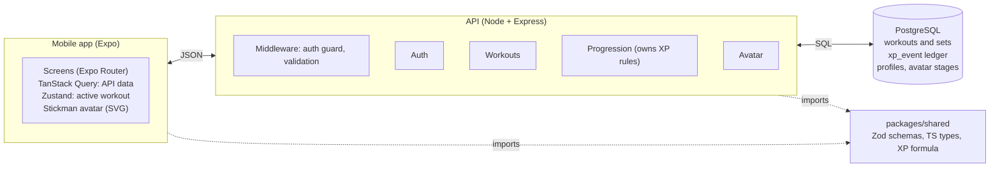

# Level Up — Project Context & Architecture

_Last updated: 2026-11-10 · Source of truth for architecture decisions. Keep this file in sync when decisions change._

## Vision & MVP scope

Level Up is "an RPG that improves your real body": logging real workouts earns XP, XP raises your level, and your avatar visibly grows with you. It is a portfolio project built to production standards, with the goal of launching on the app stores.

**The MVP is one core loop, done well:**

1. Log a workout (exercises, sets, reps, weight).
2. The server awards XP for it.
3. XP raises your level.
4. Your avatar changes as you level up.

**In the MVP:** register and log in, a predefined exercise library, workout logging that tolerates bad gym signal, XP and levels with a weekly consistency streak, a stickman avatar that grows, and a home screen showing avatar, level and XP bar.

**Deferred until the loop works:** custom exercises, cosmetics shop and unlocks beyond growth stages, quests, muscle-group variety bonus, achievements, the rules-based coach, leaderboards, social features, and any AI.

## Working agreement

This project is a learning experience as much as a product. Claude acts as a senior engineer mentoring a junior developer, not as a code generator.

- Explain every architectural decision, and why one option beats another.
- Point out trade-offs; when several good solutions exist, say why one was chosen.
- Explain what each file and class is responsible for, and why it lives where it does.
- Explain framework internals (React Native, Expo, Express, Prisma, Postgres) instead of assuming prior knowledge.
- Follow Clean Architecture, SOLID and single-responsibility where they help; prefer maintainability over cleverness.
- Small, meaningful Git commits; good documentation alongside the code.
- Flag design issues early, and explain the reasoning before changing an agreed design.

## Tech stack

TypeScript runs end to end, so types are shared between the app and the API. This stack replaces the earlier Flutter + Firebase version (paused at Milestone 3, October 2026).

| Layer | Choice | Why |
| --- | --- | --- |
| Mobile app | React Native + Expo + TypeScript | One codebase for iOS and Android; Expo handles builds, store submission and over-the-air updates |
| Navigation | Expo Router | File-based routes, auth-guarded route groups, deep linking |
| Server data | TanStack Query | Caching, retries and refetching for API data |
| Local UI state | Zustand (persisted) | Holds the in-progress workout on the device |
| API | Node.js + Express + TypeScript | Own backend; the service layer owns all workout, XP and level rules |
| Validation | Zod (shared) | One schema validates requests on the server and forms in the app |
| Database | PostgreSQL + Prisma | Relational data fits workouts and sets; Prisma gives typed queries and migrations |
| Auth | Better Auth (library inside our API) | Proven password and session handling without vendor lock-in |
| Local dev | Docker Compose | Runs Postgres locally the same way every time |
| Tooling | VS Code, Git, GitHub, MacBook Air M3 | |

## Architecture principles

Six rules keep the app simple today and launchable later. Each one is recorded with its trade-off in the decision log.



The Progression module is the only place XP is calculated; the app and API share types and the level formula through `packages/shared`.

1. **Modular monolith.** One API, split into modules (auth, users, exercises, workouts, progression, avatar). Each module owns its routes, service and data access. Modules talk through service functions, never each other's tables. One Node server plus Postgres can serve tens of thousands of users; a module can be split out later if it ever needs to be.
2. **The server owns the game rules.** The app sends what was lifted, never how much XP to award. This blocks cheating before leaderboards exist, and lets us rebalance progression without an app update.
3. **XP is a ledger.** Every XP gain is its own row. Total XP is the sum; level is calculated from total XP. A cached total on the user keeps reads fast, but the ledger is the source of truth.
4. **Offline-tolerant logging.** The in-progress workout lives on the phone. "Finish" sends it with a client-generated ID, so a retry on bad signal cannot count the workout twice (an idempotent request).
5. **Proven auth, not home-made.** Better Auth handles password hashing, sessions and resets inside our own API.
6. **Cosmetics are data, not code.** Avatar stages and items live in the database with their unlock rules, so new content needs no app release.

Each API module follows the same layering: route → controller (HTTP in/out) → service (business rules) → repository (Prisma queries) → Postgres. Controllers never hold rules; services never know about HTTP. Services report expected failures by throwing an `AppError` with a domain `kind` (`not_found`, `conflict`) and a stable `code` (e.g. `UsernameTaken`); the one error handler maps it to a status code, and every error response has the shape `{ error, message, issues? }`. Request bodies are checked by a `validateBody(schema)` middleware using the shared Zod schemas.

## Repository structure

One monorepo holds the app, the API and the shared types, managed with pnpm workspaces. A change to an API contract and the app code that uses it land in the same commit.

```text
Level-UP/
├── apps/
│   ├── mobile/                 # Expo app
│   │   ├── app/                # Expo Router screens: (auth)/, (app)/
│   │   └── src/
│   │       ├── components/     # reusable UI (Button, XpBar, Avatar)
│   │       ├── features/       # auth, profile, workouts, exercises, progression, avatar
│   │       ├── lib/            # API client, query client, storage
│   │       └── stores/         # Zustand stores (active workout)
│   └── api/                    # Express API
│       ├── prisma/schema.prisma
│       └── src/
│           ├── modules/        # auth, users, exercises, workouts, progression, avatar
│           ├── middleware/     # auth guard, error handler, request validation
│           ├── config/         # env loading and checks
│           └── app.ts
├── packages/
│   └── shared/                 # Zod schemas, TS types, XP formula
├── docs/                       # Architecture, Decisions, Roadmap, DevelopmentJournal
├── docker-compose.yml          # local Postgres
├── .github/workflows/          # CI
├── CLAUDE.md                   # context for Claude in VS Code
└── README.md
```

The XP-to-level formula lives in `packages/shared`, so the app can draw the XP bar with the same maths the server uses. The server still decides how much XP is awarded.

## Initial data model

Eight tables cover the MVP. Better Auth creates and owns its own user, session and account tables; our `profile` table extends that user with game data.

| Table | Key fields | Purpose |
| --- | --- | --- |
| profile | user_id, username (citext: unique ignoring case), total_xp (cached), avatar_stage, bodyweight_kg, weekly_target, streak_weeks, created_at | Game identity for each user |
| exercise | id, name, muscle_group, body_part, category, load_factor, bodyweight_ratio, is_custom, owner_id | Predefined library now; custom exercises later via owner_id |
| workout | id, user_id, client_id (unique), started_at, finished_at | One gym session; client_id makes "Finish" safe to retry |
| workout_exercise | id, workout_id, exercise_id, order | Which exercises were done, in order |
| workout_set | id, workout_exercise_id, reps, weight_kg, set_order | Each set performed |
| xp_event | id, user_id, amount, source, source_id, body_part, created_at | The XP ledger: one row per XP gain |
| avatar_stage | level_required, name, asset_key | Growth stages of the avatar, stored as data |
| cosmetic | id, slot, name, unlock_rule | Later: unlockable items (hair, outfit, pose) |

**XP source (decided for Milestone 3, can change later):** volume. Workout XP comes from sets × reps × weight, plus a bonus for hitting the weekly training target that grows with a weekly streak. So no exercise is penalised for its natural load, each set uses an effective load: weight + (bodyweight × the exercise's bodyweight_ratio), multiplied by the exercise's load_factor. A push-up counts part of your bodyweight, a pull-up counts all of it, and a light isolation lift like a lateral raise gets a higher load_factor so a hard set earns about as much as a hard squat set. Both values are tuned per exercise in the database. Later, training several muscle groups earns more than repeating one.

## XP & level system

Level is never stored as truth: it is calculated from total XP, so the curve can be rebalanced at any time. The starting curve makes each level take a little longer than the last:

```
XP to reach level n = 100 × (n − 1)^1.5
```

That puts level 2 at 100 XP, level 5 at 800 XP, level 10 at 2,700 XP and level 20 at about 8,300 XP. These numbers are a first guess to tune once real workouts are logged.

- **Where XP comes from:** workout volume (sets × reps × weight) plus a weekly consistency bonus and streak (MVP); muscle-group variety, quests and achievements later, each as a new `source` in the ledger.
- **Who calculates it:** the progression service on the server, in the same database transaction that saves the workout.
- **Where the formula lives:** `packages/shared`, with unit tests, so app and server agree on level boundaries.
- **Level-up moment:** the "Finish workout" response returns XP gained, old level and new level, so the app can play the level-up screen without a second request.

**Limits against fake or inflated workouts** (values to tune later):

- **Daily soft cap:** full XP up to a daily limit, then 25% XP beyond it, with a hard ceiling at twice the limit. A soft cap rewards a genuinely big day without making a fake 1,000-pull-up day worth it.
- **Plausibility checks per set:** reps or weight far beyond a realistic range for that exercise earn no XP and are flagged instead of rejected, so honest typos can be fixed.
- **Special events later:** marathons and other big efforts get their own XP source with its own limits, rather than raising the daily cap for everyone.
- **Server-side only:** all caps run in the progression service, so they can be tuned without an app update.

## Avatar prototype: a stickman that grows

The first avatar is a stickman drawn in code with `react-native-svg`. No art assets are needed, and growth is just numbers: limb thickness, shoulder width and head size change with the stage. Later we can swap the renderer for layered 2D art (and possibly 3D after that) without changing the data model.

**Each body part grows on its own.** Every exercise belongs to a body part (chest, back, shoulders, arms, core, legs), and its XP also counts toward that part. Skip leg day and the stickman's legs stay thin while the arms grow. The overall level and stage below still come from total XP; the body parts decide the shape.

- Body-part XP is tracked in the ledger (`xp_event.body_part`) with a cached total per part, so it can be rebalanced like overall XP.
- The avatar takes one development value per body part (for example 0 to 1) and draws each limb from it. The same values will drive the layered 2D or 3D art later.
- To encourage balanced training, the home screen points out the weakest body part, and the later variety bonus gives extra XP for training neglected parts.

| Stage | Unlocks at | Look |
| --- | --- | --- |
| Rookie | Level 1 | Thin lines, narrow shoulders |
| Regular | Level 5 | Thicker limbs, slightly wider shoulders |
| Athlete | Level 10 | Broad shoulders, chest and arm shapes appear |
| Champion | Level 15 | Full build plus a headband |
| Legend | Level 20 | Full build plus a cape and a glow |

- The `Avatar` component takes a stage config (stroke width, shoulder width, extras), never a level, so the art and the rules stay separate.
- Stage thresholds live in the `avatar_stage` table and can be tuned without a release.
- A small growth animation plays on the level-up screen when the stage changes.

## Production readiness plan

These are designed in from day one but switched on when the milestone needs them, so none of them slows down the first build.

| Concern | Approach | When |
| --- | --- | --- |
| Code quality | ESLint, Prettier, strict TypeScript | Milestone 1.5 |
| CI | GitHub Actions: type check, lint and tests on every push | Milestone 1.5 |
| Tests | Vitest unit tests for pure logic (XP formula, shared schemas); API integration tests with Supertest against a real Postgres test database (`levelup_test`, wiped before each test; CI uses a Postgres service container) | From Milestone 2 |
| Config and secrets | `.env` files validated at startup with Zod; never committed | Milestone 1.5 |
| Errors and crashes | Sentry in the app and the API | Before beta |
| Hosting | API in a Docker container on a managed host; managed Postgres with backups | Before beta |
| App builds | Expo EAS builds, store submission, over-the-air updates | Before beta |
| Security | Rate limiting on auth routes, Helmet headers, input validation on every route | Milestone 2 onwards |

The hosting provider is still open; the shortlist is Render, Railway or Fly.io for the API, and Neon or Supabase for Postgres.

## Roadmap & milestones

Each milestone ends in something that runs end to end on a phone, not a pile of half-built layers.

1. **Design the core screens.** Mock up avatar creation, home (avatar + level + XP bar), log workout, and the level-up moment.
   - Done when: the four screens are agreed and the data each one needs is listed.
2. **Foundation.** Monorepo, Docker Postgres, Prisma, Express API, Expo app, lint and CI.
   - Done when: the phone calls `GET /health`, the API reads from Postgres, and CI is green.
3. **Authentication.** Register, log in, log out, session kept across restarts, profile created on sign-up.
   - Done when: a new user signs up on the phone and lands on an auth-guarded home screen.
4. **Workout logging.** Exercise library, start a workout, add sets offline, finish with a safe retry.
   - Done when: a workout logged in airplane mode saves exactly once after reconnecting.
5. **Progression.** XP ledger, level formula, XP bar, level-up screen.
   - Done when: finishing a workout shows XP gained and, when earned, a level-up.
6. **Stickman avatar.** Growth stages driven by level, body parts driven by body-part XP.
   - Done when: the avatar visibly changes at levels 5, 10, 15 and 20, and untrained body parts stay thin.
7. **Beta readiness.** Hosting, Sentry, EAS builds, testers on TestFlight and Google Play internal testing.
   - Done when: five real people use it at the gym for two weeks.

After the beta: variety bonus, quests, achievements, the rules-based coach, cosmetics, then leaderboards and social features.

## Decision log

Newest first.

| Date | Decision | Trade-off accepted |
| --- | --- | --- |
| 2026-11-10 | API tests run against a real Postgres test database, no Prisma mocks; test files run one at a time | Slower tests that need Docker; they catch real SQL, constraint and migration bugs that mocks would hide |
| 2026-11-10 | Usernames unique ignoring case (Postgres `citext`), letters, digits and `_` only | Postgres-specific column type; no impersonation by case or look-alike characters |
| 2026-11-10 | Services throw `AppError` (kind + code); one error handler maps it to HTTP | One more small abstraction; services stay HTTP-free and the app branches on stable codes |
| 2026-11-08 | Each body part grows from its own XP | More data to track; avatar reflects real training balance |
| 2026-11-08 | Daily XP soft cap and per-set plausibility checks | Rare genuine huge days earn less; fake workouts stop paying off |
| 2026-11-08 | XP from volume with per-exercise load_factor and bodyweight_ratio, plus weekly streak bonus | Per-exercise tuning work; no exercise is penalised for its natural load |
| 2026-11-08 | Stickman avatar drawn in code for the prototype | Less visual appeal now, in exchange for zero art work and a fast loop |
| 2026-11-08 | Better Auth inside our own API | More to set up than a managed service; no vendor lock-in and more learning |
| 2026-11-08 | XP stored as a ledger; level derived from XP | Slightly more complex queries; full history and easy rebalancing |
| 2026-11-08 | Server owns all XP and level rules | Every award needs a network call; no client-side cheating |
| 2026-11-08 | Offline-tolerant logging with idempotent "Finish" | Sync logic to build; works with bad gym signal |
| 2026-11-08 | Modular monolith instead of microservices | One deployable unit to scale; far less operational work |
| 2026-10 | Restart on React Native + Expo, Node + Express, PostgreSQL + Prisma | Lose the Flutter + Firebase progress; gain one language, a relational model and our own backend |
| 2026-08 | Rules-based coach for the MVP, no AI | Less "smart"; predictable, testable, free to run |
